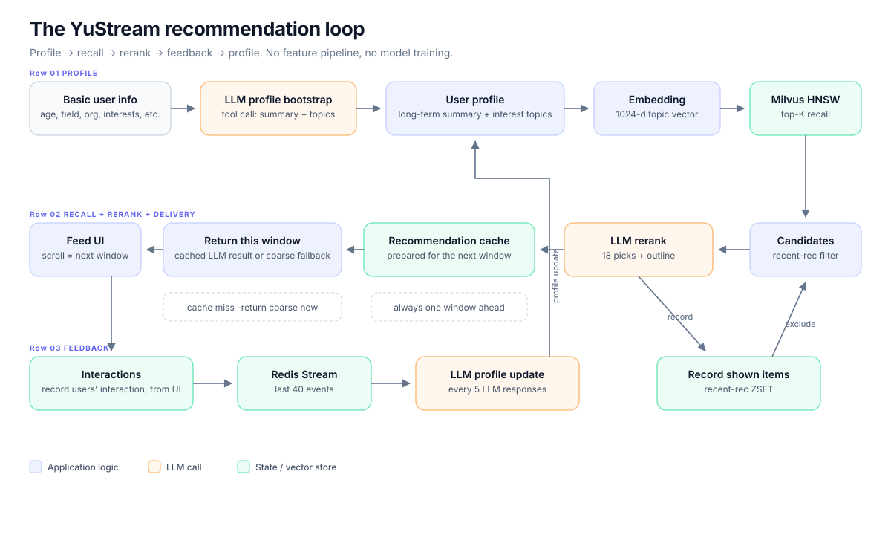

<div align="center">

# YuStream

**面向垂类产品的提示词优先、向量+LLM驱动的流式推荐框架。**

参考实现：**LitStream** —— arXiv 论文推荐。

[Online LitStream](https://nexel.dpdns.org) | 
[Docs](docs/README.md) | 
[License](LICENSE) |
[English](README.md)

</div>

> YuStream 是一个由 LLM API 驱动的垂类推荐框架。它不搭建特征工程、不训练排序模型、也不维护独立推理服务：你只需要用提示词描述垂类逻辑，把物品库向量化，让 LLM 维护用户画像并对候选集做精排。
>
> LitStream 是本仓库中的参考应用：一个 arXiv 论文流式推荐站点。它使用 Milvus 做召回，使用 DeepSeek 做画像与精排，使用 DashScope 做向量化。

**项目状态：** 研究与工程原型。推荐闭环、认证、数据入库和 Docker 部署均已可用；性能与成本基准尚未发布，见 [§4](#4-性能测试)。

> 文档正文（`docs/`）为英文；本文件提供中文项目概览与入口。

---

## 目录

1. [什么是 YuStream？](#1-什么是-yustream)
   - [1.1 特点](#11-特点)
   - [1.2 与其他方案对比](#12-与其他方案对比)
2. [YuStream 内部是怎么工作的？](#2-yustream-内部是怎么工作的)
3. [快速开始](#3-快速开始)
   - [3.1 在线体验](#31-在线体验)
   - [3.2 使用 Docker Compose 搭建](#32-使用-docker-compose-搭建)
4. [性能测试](#4-性能测试)
5. [其他](#5-其他)

---

## 1. 什么是 YuStream？

YuStream 是一个**框架 + 可运行参考应用**，面向中小垂类产品推荐。核心闭环：

```text
用户基本信息 ──LLM──> 用户画像（summary + 兴趣点）
                              │
                         兴趣点 embedding
                              │
                        Milvus 向量召回
                              │
                        过滤近期推荐
                              │
                  LLM 精排 / 直接粗排返回
                              │
                          推荐窗口（feed）
                              │
                 交互行为（click / scroll / like / view）
                              │
                   每 N 轮：LLM 更新用户画像
                              └──────────────► 用户画像
```

这里没有模型训练，也没有特征仓库。“查询”是持续维护的用户画像，“文档”是每个物品的文本摘要。这正是它搭建成本低、且能较快迁移到不同垂类的原因。

### 适用场景

- 中小规模垂类物品库，专门组建推荐团队不划算。
- 冷启动产品，几乎没有历史交互数据。
- 物品文本信息丰富、语义重要的领域：论文、课程、职位、商品、活动、内容、内部知识库。
- 希望快速迭代推荐策略，用提示词而不是重新训练模型来调整逻辑的团队。

<!-- ### 不适用场景

- 十亿级物品库，或要求 p99 低于 100 ms 的排序。
- 广告竞价、收入约束下的流量分配。
- 已有成熟行为推荐系统、且离线/在线指标充分的大规模场景。
- 需要完全事实正确、可审计、无人工复核的自动决策。LLM 只能从候选集中选择，但提示词不是正确性证明。 -->

### 1.1 特点

**1）成本低**

- 不需要特征工程、训练任务、模型仓库和独立推理集群。
- 一个 Go 服务（HTTP 与异步 worker 同进程）+ 一个静态 Vue 前端。
- LLM 调用异步化，并通过“领先一轮”的推荐缓存隐藏延迟；请求不会阻塞等待 LLM。
- 面向单机部署：应用层只是一个小型 Go 二进制 + 静态资源，内存下限由 Milvus / MySQL / Redis 决定，而不是 ML 运行时。
- LLM 慢、不可用或缓存未命中时，自动退回向量粗排，feed 始终有内容可展示。

**2）易复用**

- 垂类逻辑集中在提示词和物品 schema 中。
- 参考实现把离线链路独立为 `searcher/`：把 arXiv 换成你的物品源，其余链路可以复用。
- 迁移一个新垂类通常只需要：数据源适配、字段映射、提示词重写、embedding 模型/维度选择、前端文案。
- 如果物品可以套用现有的 `title + abstract/description + tags + summary` 结构，schema 可以完全不动。

**3）语义驱动、冷启动友好**

- 召回由 embedding 驱动，不依赖历史共现。
- 新用户填完简短资料即可获得推荐，不需要交互历史。
- 画像把长期、可读的 `summary` 与短期 `interest_topics` 分开；只有兴趣点会被向量化，召回更聚焦。
- 精排模型看到画像后，会推理“信息需求”，而不只是做关键词相似度。

**4）不同的交互形态**

- 不需要用户主动向推荐系统提问；系统从画像和行为中推测信息需求。
- feed 是连续的推荐窗口。用户下滑，系统观察，画像持续演化。
- 每个 LLM 精排窗口都带一段 `outline`，说明这一轮推荐的主要内容，推荐结果可被用户理解。

### 1.2 与其他方案对比

| 维度 | 传统推荐系统 | 对话式 LLM 推荐 | YuStream |
| --- | --- | --- | --- |
| 主要输入 | 历史行为、特征 | 用户每轮主动提问 | 持续维护的画像 + 交互行为；无需提问 |
| 冷启动 | 需要数据、重训或兜底策略 | 需要一轮对话 | 文本画像 + 已向量化的物品库即可 |
| 搭建成本 | 特征链路、训练、服务、实验平台 | 提示词 + 对话 UI + 检索胶水 | 提示词 + 向量库 + 一个小服务 |
| 迭代方式 | 重训 / 重部署 / 调参 | 改提示词 | 改提示词与配置；当前需要重新构建 |
| 延迟模型 | 低延迟排序服务 | 等待一轮对话生成 | 窗口为下一次下滑准备；不用等待llm输出 |
| 适合规模 | 超大规模、数据充分 | 有问答需要 | 中小规模垂类 |
| 可解释性 | 特征归因、离线指标 | 对话记录 | 可读画像 + 每轮 outline |
| 主要失效模式 | 特征过期、反馈回路 | 用户不知道该问什么、提问疲劳 | LLM 不可用时退回粗排 |
| 交互新颖性 | 成熟工程 | 对话式交互 | 维护画像、推送式流式交互 |

**对比传统推荐系统。** YuStream 去掉了最昂贵的部分：特征工程、模型训练和独立服务链路；同时把匹配从“行为相似”转为“语义契合”，在数据稀疏时更有优势。代价是规模与延迟：向量检索 + LLM 精排无法在超大规模上替代调优过的排序模型，而且 LLM 窗口刻意比当前 feed 慢一轮。

**对比现有对话式 LLM 推荐系统。** 对话式工具要求用户先提出需求，再回答追问；YuStream 维护用户画像，观察用户真正读什么，然后主动推送下一轮，不需要用户先发问。这把 LLM 推荐系统的交互形式从“问答”扩展到了“连续 feed”。代价是推测可能出错——因此画像可编辑，交互行为会持续修正画像。

**版本适应性。** 很多策略变化只需要改提示词，而不是重训模型：新的排序目标、新的多样性要求、新的“信息需求”定义，都可以写进 `backend/llm/prompt.go`。当前提示词是 Go 常量，因此修改后需要重新构建/重启；项目还没有提示词注册中心。

---

## 2. YuStream 内部是怎么工作的？



### 六步闭环

**1）画像初始化。** 用户填写年龄、性别、职业、学历、城市、机构，以及最多 10 个感兴趣领域。LLM 通过强制工具调用返回：

- `summary`：自然语言画像，包含基本信息、长期偏好话题、推测的信息需求、确定/不确定需求。
- `interest_topics`：短期、可变化的话题列表。

这个拆分是关键：`summary` 用于推理与展示，`interest_topics` 是**唯一**的召回查询。

**2）粗排召回。** 兴趣点被编码为 1024 维向量（Redis 缓存），然后在 Milvus 中用 HNSW/L2 检索。同步兜底路径只取 `LIMIT_TOP_K`（默认 18）条；异步精排会取 `SEARCH_TOP_K`（默认 100）个候选。近期已推荐物品会被过滤。候选不足时会放宽过滤，避免 feed 断粮。物品元数据先查 Redis，未命中回退 MySQL。

**3）LLM 精排。** 异步 worker 取同一批候选，把物品摘要编号后交给 LLM，要求选出 `LIMIT_TOP_K`（默认 18）个，并生成一段 `outline`。提示词要求兼顾多样性，而不只是最大相似度。模型只能返回候选编号，服务端会做边界检查。

**4）返回：永远领先一轮。** `GET /api/items/recommend` 从不同步调用 LLM：

- **缓存命中**：返回上一轮精排结果（`source=llm`），同时投递下一轮精排任务，并累加缓存命中计数。
- **缓存未命中**：立即做向量粗排（`source=coarse`）并返回，同时投递精排任务。

第一次请求通常是粗排；下一次下滑通常就能拿到 LLM 精排。用户滑得比精排快时，可能重复拿到同一缓存窗口；前端会按物品 ID 去重。

**5）反馈与画像演化。** 前端上报 `click`、`scroll`、`like`、`view` 交互，后端把每条事件写入 Redis Stream（最多 40 条，默认 14 天 TTL）。每第 5 个 `source=llm` 响应，系统投递一次增量画像更新：读取新交互（通过 Redis 指针与历史切分），让 LLM 更新画像，写回 summary/topics，删除旧兴趣点向量，成功后才推进指针。

**6）防重复。** Redis ZSET 记录最近推荐过的物品，score 等于“距展示经过的精排轮数”。每轮精排把所有 score +1，删除超过 `RECS_WINDOW` 轮的物品，并把本轮新物品以 score=0 写入；召回时排除当前窗口。默认 `RECS_WINDOW=10`、每轮 18 条，因此最多可能排除约 180 条——窗口单位是**轮数**，不是条数。

### 关键设计

| 主题 | 行为 |
| --- | --- |
| “流式”的含义 | 连续返回一个个推荐**窗口**，不是 LLM token 流式输出。 |
| 延迟隐藏 | 当前窗口走缓存/粗排；下一窗口异步准备。 |
| 画像是查询 | 不需要用户提问；画像可编辑，并随行为演化。 |
| 两段文本 | 长 `summary` 用于推理；短 `topics` 用于 embedding。 |
| 降级 | LLM 失败时缓存/粗排继续可用；画像更新稍后重试。 |
| 画像为空 | `200` + 空列表 + 投递画像生成任务，不返回 5xx。 |
| 物品库为空 | 召回报错，表现为 500；使用前必须先灌数据。 |
| 存储拆分 | Milvus 只存 `(id, vec)`；元数据在 MySQL/Redis。 |

### 技术栈摘要

| 层 | 技术 |
| --- | --- |
| 前端 | Vue 3.5、Vite 6、Pinia、Vue Router、Axios、KaTeX |
| 后端 | Go 1.26、Gin、GORM、asynq（Redis 队列）、zerolog |
| 数据 | MySQL 8（用户/物品）、Redis 7（缓存/Stream/队列）、Milvus 2.5（向量） |
| AI | DeepSeek chat（画像/精排）、DashScope embedding、Qwen 摘要/翻译 |
| 部署 | Docker Compose、Vite 代理或 Nginx 反向代理 |

完整版本与选型说明：[docs/tech-stack.md](docs/tech-stack.md)。

---

## 3. 快速开始

### 3.1 在线体验

参考应用运行在 **[https://nexel.dpdns.org](https://nexel.dpdns.org)**。

1. 使用邮箱注册（演示站需要邮箱验证码），或直接登录已有账号。
2. 填写简短资料，选择几个感兴趣领域。
3. 等待画像生成，然后下滑 feed。
4. 第一轮通常是向量粗排，后续窗口是 LLM 精排。打开卡片、点赞、连续下滑，即可看到画像随交互演化。

这是个人主机上的研究型部署；如果无法访问，可以按下面的步骤在本地运行。

### 3.2 使用 Docker Compose 搭建

#### 前置条件

- Docker Engine/Desktop，Compose v2（`docker compose version`）。
- 至少 4 GB 空闲内存，建议 8 GB。Milvus standalone、MySQL、Redis、etcd、MinIO 是内存大户。
- Node.js 18+ 与 Yarn 1.x（或 npm），用于前端。
- API Key：DeepSeek（后端 LLM）、DashScope（embedding）、阿里云 DirectMail（注册邮件）。可选：Qwen-MT 或阿里云机器翻译（中文翻译）。

#### 第 1 步：创建 `.env`

在仓库根目录：

```bash
cp .env.example .env
# Windows PowerShell: Copy-Item .env.example .env
```

至少填写：

| 变量 | 填写内容 |
| --- | --- |
| `ACCESS_TOKEN_SECRET`、`REFRESH_TOKEN_SECRET` | 足够长的随机字符串 |
| `MODEL_API_KEY`、`MODEL_NAME` | DeepSeek Key，以及该 Key 可用的模型名 |
| `EMBEDDING_MODEL_API_KEY`、`EMBEDDING_MODEL_NAME` | DashScope Key 与 embedding 模型 |
| `EMBEDDING_MODEL_BASE_URL_WITH_OPENAI` | DashScope 的 OpenAI 兼容地址 |
| `ALIYUN_ACCESS_KEY_ID`、`ALIYUN_ACCESS_KEY_SECRET` | DirectMail 发信凭据 |
| `MAIL_ACCOUNT_NAME` | 已在 DirectMail 验证的发信地址 |
| `SUMMARY_MODEL_API_KEY` | searcher 生成文献介绍所用的 Qwen MaaS Key |

`MYSQL_DSN`、`REDIS_ADDRESS`、`MILVUS_ADDRESS` 保持 Compose 默认值即可，除非你同时修改了 Compose 服务。

> Compose 中的 MySQL 密码是**开发默认值**（`123456`），示例 DSN 中也是同一个值。对外部署前必须同时修改。

所有变量说明见 [docs/configuration.md](docs/configuration.md)。

#### 第 2 步：启动后端与数据层

```bash
docker compose up -d --build
docker compose ps
curl http://127.0.0.1:8080/hello
# {"message":"Hello, World!"}
```

Milvus 首次启动可能需要 60–90 秒；后端会等待 MySQL、Redis、Milvus 健康。

#### 第 3 步：灌入物品数据

**feed 需要物品。下面的命令使用参考 arXiv searcher；如果你已有自己的入库管道，可以直接载入自己的物品并跳过这一步 —— 后端只需要匹配的 MySQL 行和 Milvus 向量。**

先抓取一天 arXiv 论文（`searcher` 是一次性 `tools` profile 任务）：

```bash
docker compose --profile tools run --rm searcher \
  -config /app/.env \
  -date 2025-01-15 \
  -max 200
```

- `-date` 按 arXiv `submittedDate` 的**美东时间**计算。
- 不传 `-max` 会抓取当天全部论文。
- 检查结果：`docker compose --profile tools run --rm searcher -config /app/.env -op stats`。

Milvus 为空时召回会报错并表现为 500，不是友好的空状态，所以务必先灌数据。

#### 第 4 步：启动前端

```bash
cd frontend
yarn install
yarn dev
# 或者：npm install && npm run dev
```

打开 **http://127.0.0.1:5173**。Vite 会把 `/api` 代理到 `http://127.0.0.1:8080`。

前端不在 `docker-compose.yml` 中：Nginx 服务是注释掉的，且其引用的文件不在仓库里。生产环境请构建 `frontend/dist`，用 Nginx/Caddy 托管，并把 `/api` 反代到后端。详见 [docs/getting-started.md](docs/getting-started.md#5-production-build)。

#### 第 5 步：首次体验

1. 注册（邮箱验证码 5 分钟有效，同一邮箱 60 秒内不能重复发送）。
2. 填写资料，至少选择一个感兴趣领域。
3. 等待画像摘要生成。
4. 下滑到底部。第一轮通常是 `coarse`，下一轮通常是 `llm`。
5. 点击、点赞、连续下滑几轮，触发增量画像更新。

#### 常见问题

| 现象 | 处理 |
| --- | --- |
| 后端报 `Can't find the file .env` | 在包含 `.env` 的目录运行；Compose 会挂载根目录 `.env` |
| 连接 Milvus 被拒 | 等待健康检查；检查 `MILVUS_ADDRESS` 与 `docker compose logs milvus` |
| `embedding 维度不符` | 让 `VEC_DIM` 与模型一致；重建 collection 并重新灌数据 |
| feed 为空或 500 | 先灌数据，再执行 `-op stats` |
| `LLM API 返回 401` | 检查 `MODEL_API_KEY`；后端端点目前固定为 DeepSeek |
| 收不到注册邮件 | 检查 DirectMail 发信地址/域名与 RAM 权限；等待 60 秒 |
| 没有中文翻译 | 配置 `TRANSLATE_PROVIDER` 及对应凭据，见 [configuration](docs/configuration.md) |

更多排查：[docs/getting-started.md](docs/getting-started.md#7-troubleshooting)。

---

## 4. 性能测试

> **待补充。**
>
> 目前不发布任何性能数字，待作者完成测试后补充。计划覆盖：首窗延迟、缓存命中延迟、精排完成时间、每窗口 token 与成本、入库吞吐、单机内存占用、并发用户行为。

---

## 5. 其他

### 5.1 将 YuStream 复用于其他垂类

从[垂类复用指南](docs/reuse-guide.zh-CN.md)开始。简要版本如下：

1. **选择任意入库路径。** `searcher/` 是可选的；想使用 arXiv 参考实现就保留它，或者为自己的 API、爬虫、CMS、CSV 或消息队列编写一个 loader。
2. 产出不变量：原始 item 字段 → 语义文本 → 嵌入向量，并把同一个 ID 写入 MySQL 和 Milvus。
3. 决定唯一被嵌入的文本字段；保持它与精排器看到的文本一致。
4. 重写 `backend/llm/prompt.go` 中的提示词集合；如果使用参考 searcher，还要修改 `searcher/llm/summary.go` 中的摘要提示词。
5. 保留画像/topics 的拆分与输出 schema（工具调用字段、从 1 开始的下标、outline）。
6. 调整交互事件以及卡片/详情页文案。
7. 调优 `SEARCH_TOP_K`、`LIMIT_TOP_K`、`RECS_WINDOW` 和各类 TTL；在固定候选集上评估。

如果你的物品不符合现有 schema，还需要改动 item 模型、入库映射和前端展示辅助函数。指南中列出了所有这些位置。

### 5.2 扩展或优化框架

YuStream 从设计上支持两种改动方式：

- **案例扩展：** 在现有闭环之上增加新的垂类或产品场景。参见[垂类复用指南](docs/reuse-guide.zh-CN.md)。
- **框架优化：** 替换或改进核心 —— 检索、精排、画像、队列、缓存、成本、可观测性或多租户。参见[扩展与优化](docs/extending.zh-CN.md)。

两者都是正当的。增加垂类不需要 fork，改进框架也不需要保留当前的每一个组件。应保持稳定的契约（item ID 映射、API 形状、工具调用 schema、Redis 状态语义）列在扩展指南中。

### 5.3 代码结构

- [后端结构](docs/backend-structure.zh-CN.md) —— 分层、启动装配、同步与异步路径、任务类型、提示词，以及已知的粗糙之处。
- [前端结构](docs/frontend-structure.zh-CN.md) —— 路由、布局、store、feed 机制、交互，以及构建/部署。
- [数据管道](docs/data-pipeline.zh-CN.md) —— 参考 arXiv 管道与入库契约；`searcher/` 本身是可选的。

### 5.4 文档

| 文档 | 涵盖内容 |
| --- | --- |
| [docs/README.zh-CN.md](docs/README.zh-CN.md) | 文档索引与阅读路径 |
| [English docs](docs/README.md) | 所有文档页面的英文原文 |
| [快速开始](docs/getting-started.zh-CN.md) | 本地与 Docker 搭建、灌数据、生产构建、故障排查 |
| [配置](docs/configuration.zh-CN.md) | 每个 `.env` 变量、默认值与修改矩阵 |
| [架构](docs/architecture.zh-CN.md) | 闭环、数据模型、失败处理、权衡、限制 |
| [技术栈](docs/tech-stack.zh-CN.md) | 版本、端口、供应商选择，以及刻意缺失的部分 |
| [后端结构](docs/backend-structure.zh-CN.md) | Go 包地图与扩展点 |
| [前端结构](docs/frontend-structure.zh-CN.md) | Vue 应用地图与 feed/认证流程 |
| [数据管道](docs/data-pipeline.zh-CN.md) | 参考入库流程与 item/语义/向量契约 |
| [HTTP API](docs/api.zh-CN.md) | 端点、请求负载、状态码、限流 |
| [垂类复用指南](docs/reuse-guide.zh-CN.md) | 适配、迁移、成本、评估、合规 |
| [扩展与优化](docs/extending.zh-CN.md) | 案例扩展、框架级改动、契约、迁移 |

### 5.5 贡献

- 改动某一层之前，先阅读[架构](docs/architecture.zh-CN.md)和对应的结构文档。
- 遵守分层规则：controller/worker 保持轻薄；业务决策位于 `service`；repository 不调用 LLM，也不入队任务。
- 提示词是产品体验的一部分。修改提示词时要附上评估用例，而不只是凭感觉。
- 提交 PR 前，后端运行 `go build ./cmd`，前端运行 `yarn build`。`backend/test/` 目录包含依赖真实服务的临时/集成程序；不要把它当作常规单元测试套件。
- 两类贡献都欢迎：新的垂类案例（提示词 + 映射 + 示例数据契约）和框架优化（检索、精排、画像、serving、评估）。参见[扩展与优化](docs/extending.zh-CN.md)。
- 不要提交 `.env`、API 密钥或个人数据。

### 5.6 安全

参考部署将后端绑定到 `127.0.0.1`，并假定前面有同源反向代理。公开使用前：修改默认数据库凭证、轮换所有密钥、启用 TLS、保持 MySQL/Redis/Milvus/MinIO 私有、制定画像/交互删除策略，并审阅 LLM 供应商的数据保留条款。

---

<div align="center">
<sub>核心想法很简单：让用户画像成为查询。</sub>
</div>
