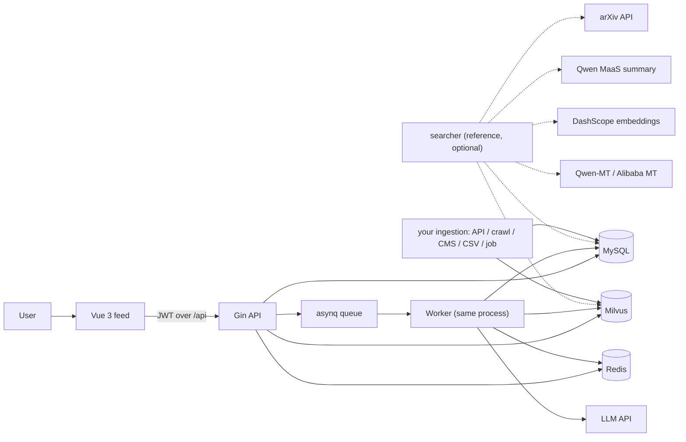
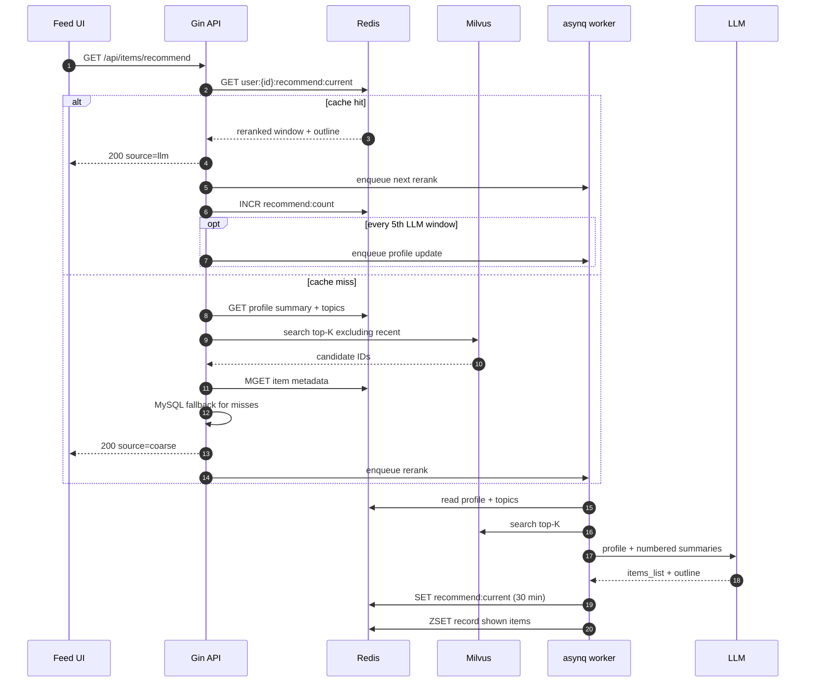

# Architecture

[English](architecture.md) · [中文](architecture.zh-CN.md)

This document explains how YuStream turns a text profile into a stream of recommendations, where state lives, and which trade-offs are deliberate.


## 1. Design goals and non-goals

### Goals

- **No training pipeline.** The domain logic lives in prompts, an item schema, and an ingestion adapter — not in a feature store or a trained model.
- **Semantic cold start.** A new user can receive useful recommendations from a text profile and an embedded catalog, without historical interactions.
- **Bounded feed latency.** A feed request must never wait for an LLM. The current window is served from cache or vector recall; the next window is prepared asynchronously.
- **Cheap adaptation.** Moving to a new vertical should mostly mean rewriting prompts, replacing the catalog source, and re-embedding.
- **Single-machine friendliness.** The application layer is a single Go service plus a static frontend. The data layer (Milvus, MySQL, Redis) dominates memory use.

### Non-goals

- Web-scale retrieval (billions of items) or sub-100 ms p99 ranking.
- Ad auctions, bidding, or revenue-constrained ranking.
- Replacing a mature recommender where behavioral data and measured CTR are abundant.
- Guaranteeing factual correctness of LLM output. The reranker is constrained to choose from supplied candidates, but prompts are not a proof.
- Multi-tenant SaaS out of the box. One deployment currently serves one vertical and one Milvus collection.

## 2. System context



| Component | Role | State |
| --- | --- | --- |
| Vue 3 SPA | Auth, onboarding, feed, profile, detail, interaction capture | Browser localStorage for session and display preferences |
| Gin API | Sync request handling, auth, rate limits, cache/recall reads, task enqueue | Stateless |
| asynq worker | Profile generation/update, reranking | Same process as the API in the reference implementation; shares services |
| MySQL | Users, profiles, item metadata | Durable |
| Redis | Caches, interaction streams, recommendation cache, recent-recommendation ZSET, queue | TTL-bound / queue-backed |
| Milvus | `id` + embedding vector only | Durable vectors; metadata stays in MySQL |
| searcher | **Reference** offline producer for arXiv; optional | Writes MySQL and Milvus directly |
| Your ingestion | Any source and any tool | Must write the same item contract to MySQL and Milvus |

The backend does not use a separate feature store, model server, or vector-metadata service. It also does not import the searcher: it only reads MySQL and Milvus. This is the main architectural simplification: **the profile is the query, and the item summary is the document**.

### 2.1 The catalog contract

`searcher/` is one reference implementation, not a required component. You can ingest through an official API, a crawl, a CMS export, a CSV, a message queue, or an internal batch job. The runtime only requires the following chain:

```text
raw item information
      │  (any source and any tool)
      ▼
item semantic text
      │  (summary / enriched description / title + attributes)
      ▼
embedding vector
      │
      ├── MySQL: items row with the same id, display fields, and semantic text
      └── Milvus: (id, vec) with the same id
```

Three rules make an ingestion pipeline compatible:

1. **Same ID.** The MySQL `items.id` written to Milvus must be the same ID the backend will load. In the reference searcher, the MySQL insert returns the auto-increment ID and the searcher writes that ID to Milvus.
2. **Same embedding space.** The searcher and the backend must use the same embedding model and `VEC_DIM`. Vectors from different models are not comparable.
3. **One semantic text.** The text embedded for recall should be the text the reranker sees (or a faithful derivative). LitStream uses `items.summary` for both.

If these hold, the backend does not care how the data arrived. See [Data pipeline](data-pipeline.md) for the reference implementation and [Extending and optimizing](extending.md) for alternative ingestion paths.

## 3. The recommendation loop

### 3.1 Profile bootstrap

On first use, the user submits a small set of fields:

- age, gender, job, education, location, organization
- up to 10 `interesting_fields`

The `user_summary:generate` task calls the LLM with a forced tool call (`extract_user_profile`) and receives two fields:

| Field | Purpose | Where it is used |
| --- | --- | --- |
| `summary` | A readable, natural-language profile: basic facts, long-term topics, inferred information needs, and uncertain needs | Passed to the reranker as context; shown in the UI |
| `interest_topics` | A short, deliberately unstable list of current topics | Embedded and used as the **only** recall query |

This split is the core prompt-design choice:

- The **summary** is allowed to be long, nuanced, and speculative. It is for reasoning.
- The **topics** must stay short and concrete because every token becomes part of the retrieval query. The update prompt explicitly asks to keep the format stable so vectors remain comparable.

The profile is stored in MySQL (`users.summary`, `users.topics`) and cached in Redis. Saving a profile invalidates the cached topic vector so the next recall recomputes it.

### 3.2 Recall (coarse ranking)

`fetchCandidates` is shared by the synchronous fallback and the asynchronous reranker:

1. Read `summary` and `topics` (Redis hash, MySQL fallback).
2. Embed `topics` with the configured embedding model. The vector is cached in Redis under `vec:user:{id}`.
3. Search Milvus with HNSW/L2 for a configurable top-K, excluding recently recommended items. The synchronous coarse path asks for `LIMIT_TOP_K` (18); the asynchronous reranker asks for `SEARCH_TOP_K` (100).
4. If fewer than the requested top-K remain, search again **without** the exclusion filter to avoid starving the feed.
5. Load item metadata by ID: Redis `MGET`, then MySQL for misses, then backfill Redis.

Defaults in the reference app: `SEARCH_TOP_K=100`, `LIMIT_TOP_K=18`, `VEC_DIM=1024`.

Milvus stores only `(id, vec)`. All filtering and display fields come from MySQL/Redis. This keeps the vector collection small and makes metadata changes possible without re-embedding. The recall path does not know or care whether the item came from `searcher/` or your own loader; it only sees the item contract.

### 3.3 Rerank (LLM decision)

The asynchronous task `recommendation:generate` runs the reranker:

1. Fetch up to `SEARCH_TOP_K` candidates.
2. Number the candidates and pass their **summaries** (not full abstracts) to the LLM.
3. The LLM receives the profile summary, the interest topics, and the candidate list.
4. A forced tool call returns:
   - `items_list`: 1-based indices of the chosen items
   - `outline`: a short description of the recommended set
5. The service maps indices back to items, bounds-checks them, records the shown items in the recent-recommendation ZSET, and writes the result to Redis.

The prompt asks for diversity, not just maximal similarity, to reduce the information cocoon. The LLM can only choose from supplied indices; it cannot invent items.

> **Prompt-size warning.** The reranker prompt contains every candidate summary. With `SEARCH_TOP_K=100` and summaries near the 500-token guidance, the prompt can become large. Reduce `SEARCH_TOP_K`, shorten summaries, or truncate per-item text before scaling traffic.

### 3.4 Delivery: always one window ahead

`GET /api/items/recommend` is intentionally **synchronous without an LLM call**:

```text
cache hit  -> return the previously reranked window  (source=llm)
             + enqueue the next rerank
             + increment the LLM-window counter

cache miss -> run vector recall now                   (source=coarse)
             + return immediately
             + enqueue a rerank for a later window
```

The first request after login is normally coarse. By the time the user scrolls to the bottom, the first reranked window is often ready, so the next request returns `source=llm`. This is the "one window ahead" latency-hiding strategy.

Consequences:

- No request waits for an LLM; the feed always has something to show if the catalog is non-empty.
- If the user scrolls faster than reranking completes, the same cached window can be returned again. The frontend de-duplicates by item ID and appends only new items.
- The recommendation cache is **one slot per user** (`user:{id}:recommend:current`), not a keyed history of windows. A new rerank overwrites the previous one. The code comments in a few places still describe a per-window `key`; the implementation is the single-slot variant.
- The cache TTL is `RECOMMEND_TTL` (30 minutes by default). After expiry, the next request falls back to coarse.

### 3.5 Feedback and profile evolution

The frontend reports interactions to `POST /api/interactions`. Each event is appended to a Redis Stream (`user:{id}:interactions`, max 40 entries, 14-day TTL by default).

| Type | Meaning | `target` | `detail` | `long_ts` |
| --- | --- | --- | --- | --- |
| `click` | Card opened or original link clicked | The item | `card` or `link` | 0 |
| `scroll` | A recommendation window was browsed | Empty | The window `outline` | Dwell time in **seconds**, capped at 5 min |
| `like` | Item liked | The item | Empty | 0 |
| `view` | Detail dwell event | The item | Empty | Dwell time in **seconds**, capped at 3 min |

The LitStream UI emits all four types. `view` is settled when the detail modal closes; the timer lives in the `ui` store, not in `ItemDetailPanel.vue`. `scroll` is emitted only for `source=llm` windows, because a coarse window has no LLM-generated `outline` to describe it.

Profile updates are **incremental**:

1. Every fifth cache-hit response (`source=llm`), `GetRecommend` enqueues `user_summary:update`.
2. The worker reads the interaction stream and splits it at a Redis pointer into "new" and "history".
3. The LLM receives the old profile, historical interactions, and new interactions.
4. On success, the new `summary` and `topics` are written back, the topic vector is deleted, and the pointer advances.

The pointer advances only after a successful write. A failed LLM call therefore leaves the interactions eligible for the next attempt instead of silently skipping them.

### 3.6 Anti-repeat

`user:{id}:recentlyrecommended` is a Redis ZSET whose **score is the number of rerank rounds since the item was shown**:

- On each rerank, every existing member's score increments by 1.
- Members with score `>= RECS_WINDOW` are removed.
- The newly shown items are inserted at score 0.
- Recall excludes members with score `0 .. RECS_WINDOW-1`.

So `RECS_WINDOW=10` means "the last 10 rerank rounds", not "the last 10 items". With `LIMIT_TOP_K=18`, that is up to ~180 excluded items. If recall falls below `SEARCH_TOP_K`, the service deliberately retries without the filter; a repeated item is possible, and the client de-duplicates it.

## 4. Request lifecycle



If the profile does not exist yet, the API returns `200` with an empty list and `source=empty`, and enqueues profile generation. It does not return a 5xx for a missing profile.

## 5. Data model

### MySQL

`users` (GORM `domain.User`):

| Column | Notes |
| --- | --- |
| `id` | Primary key |
| `username` | Display nickname, 2–15 non-space characters |
| `email` | Unique login identifier |
| `password` | bcrypt hash |
| `age`, `gender`, `job`, `education`, `location`, `organization` | Profile inputs |
| `interesting_fields` | JSON array, max 10 |
| `summary` | LLM-generated natural-language profile |
| `topics` | LLM-generated short-term interest topics (the recall query) |

`items` (GORM `domain.Item`):

| Column | Notes |
| --- | --- |
| `id` | Auto-increment, also the Milvus primary key |
| `title`, `web_source`, `url`, `publish_date` | Metadata; `url` is the dedupe key for arXiv |
| `authors`, `fields`, `keywords` | JSON arrays |
| `abstract` | Original abstract |
| `is_chinese`, `title_chinese`, `abstract_chinese` | Translation state and text |
| `summary` | Enriched, embedding-ready summary; also shown as "recommendation reason" |

### Redis

| Key | Type | TTL (default) | Purpose |
| --- | --- | --- | --- |
| `user:{id}` | Hash | 72 h | Profile cache: basic fields, `summary`, `topics`, interests |
| `email:{email}` | String | 72 h | Email → user ID lookup |
| `vec:user:{id}` | Binary string | 72 h | Cached float32 topic vector; deleted when profile changes |
| `user:{id}:interactions` | Stream | 14 days | Interaction events, capped at 40 |
| `user:{id}:interactions:ptr` | String | 14 days | Last processed stream ID |
| `user:{id}:recommend:current` | String (JSON) | 30 min | Current reranked window + outline |
| `user:{id}:recommend:count` | String | — | Counter; resets at 5 to trigger profile update |
| `user:{id}:recentlyrecommended` | ZSET | — | Anti-repeat window; score = rounds since shown |
| `item:{id}` | String (JSON) | 168 h | Item metadata cache |
| `rl:*` | String | per limiter | Login/signup/email rate limits |

### Milvus

| Field | Type | Notes |
| --- | --- | --- |
| `id` | `Int64`, primary | Same value as `items.id`; no auto-ID |
| `vec` | `FloatVector(VEC_DIM)` | Embedding of `items.summary` |

Index: HNSW, L2, `M=16`, `efConstruction=64`. Search `ef` is at least `2 × topK`. The collection is created and loaded idempotently at startup.

## 6. Failure handling

| Failure | Behavior | User impact |
| --- | --- | --- |
| LLM timeout / 5xx during rerank | asynq retries up to 3 times; current cache/coarse remains | Feed keeps working; LLM windows may lag |
| LLM failure during profile update | Task retries; interaction pointer is **not** advanced | Profile update is delayed, interactions are not lost |
| Recommendation cache miss / expiry | Synchronous coarse recall | Slightly less personalized window; no wait |
| Redis read error on cache | Logged; coarse fallback | Feed continues |
| Redis interaction write error | Request returns 500; frontend sends interactions fire-and-forget | One interaction may be lost silently |
| Queue unavailable | Rerank/profile enqueue fails; API still returns current window where possible | Personalization stops advancing until Redis recovers |
| Milvus unavailable / empty collection | Recall error propagates as 500 | Feed fails until Milvus is healthy and seeded |
| MySQL unavailable | Profile/item load errors propagate | Auth and feed fail |
| Missing profile | `200` + empty list + enqueue generation | User sees an empty state, then a profile |
| Duplicate enqueue | asynq `Unique` treats duplicate as success | No duplicate work |
| Service restart | Redis queue and TTL state survive; in-flight HTTP requests do not | At most one window of extra latency |

## 7. Consistency and concurrency

- **Cache-aside everywhere.** Reads try Redis first, fall back to MySQL/Milvus, then backfill.
- **Single-flight embedding.** Concurrent requests for the same user share one embedding call; the first caller's context is detached so a cancellation does not fail the waiters.
- **Atomic recent-recommendation update.** A Lua script increments scores, trims the window, and inserts new members in one round trip.
- **Pointer after success.** The interaction pointer is advanced only after the profile write completes.
- **Transactional profile write.** `SaveSummaryAndTopics` uses a Redis transaction pipeline to update summary/topics and delete the vector, then writes MySQL.
- **MySQL first, cache second.** Profile edits write MySQL, then patch Redis. A cache failure does not roll back MySQL; the next read self-heals from MySQL.
- **Eventual profile updates.** The reranker may run once more with the previous profile before an incremental update lands. This is acceptable for a feed and avoids blocking delivery.
- **Single writer per user is not enforced.** Two workers could rerank the same user concurrently in a multi-instance deployment; the cache is last-writer-wins. asynq `Unique` reduces, but does not eliminate, this.

## 8. Security and privacy

- Passwords use bcrypt. Login is email + password.
- JWTs are HS256. Access tokens expire after `ACCESS_TOKEN_EXPIRE_HOUR` (1 h default); refresh tokens are issued but **no refresh endpoint is implemented** — the client stores the refresh token but does not use it.
- Public auth endpoints are rate-limited per IP:
  - login: 10/min
  - signup: 5/min
  - forgot password: 100/5 min
  - verification email: 10/day
- The API has no CORS middleware. The frontend is expected to be served same-origin behind a reverse proxy, or proxied by Vite in development.
- Profiles and interactions can contain personal data. They are sent to the configured LLM provider for generation/reranking. Review your provider's data-retention terms before production use.
- Redis and MySQL contain profile data with TTLs for caches but durable rows in MySQL. Define a deletion policy for user data.
- `.env` contains API keys and JWT secrets. It is git-ignored; `.env.example` is the template and must stay redacted.

## 9. Known limitations

These are current implementation facts, not roadmap promises:

1. **Hardcoded LLM endpoints.** The backend chat client posts to `https://api.deepseek.com/chat/completions`; the searcher summary client posts to a Qwen MaaS endpoint. Swapping providers requires code changes, not just `.env`.
2. **Prompts are Go constants.** Changing a prompt requires rebuilding/restarting the backend. There is no prompt registry or hot reload.
3. **One vertical per deployment.** A single `MILVUS_COLLECTION_NAME` and one prompt set. Multi-vertical routing is not implemented.
4. **One recommendation cache slot per user.** No per-window history, despite stale comments referring to a `key`.
5. **No refresh-token route.** The refresh token is currently unused by the SPA.
6. **No offline evaluation harness.** There is no labeled relevance set, no NDCG script, and no benchmark result in this repository yet.
7. **Reranker prompt growth.** Candidate count × summary length is the main token-cost lever.
8. **Empty Milvus collection is not an empty state.** Recall returns an error, which surfaces as 500. Seed the catalog first.
9. **Client-side de-duplication only.** The server does not know the full set of items the client has already rendered.
10. **No moderation or content safety layer.** Add one before exposing a new vertical to public users.
11. **No multi-tenant isolation.** All users share one catalog and one collection.
12. **The searcher is an arXiv-specific reference, not a universal connector.** It demonstrates the ingestion contract; another vertical should use whatever source and tooling fit it.

## 10. Extension points

| Need | Where to change |
| --- | --- |
| New vertical prompts | [`backend/llm/prompt.go`](../backend/llm/prompt.go), tool schemas in [`backend/llm/invoking.go`](../backend/llm/invoking.go) |
| New item fields | `backend/domain/models_domain.go`, your ingestion model, `frontend/src/utils/format.js` |
| New catalog source | Any ingestion path. Keep the item contract; use `searcher/` as a reference or write your own loader |
| Different embedding model | `EMBEDDING_MODEL_*`, `VEC_DIM`, then recreate/re-embed the collection |
| Different reranker | `ItemService.recommend`, `LLMInvoking.Recommend`, `BuildToolRecommend` |
| Different interaction policy | `InteractionService`, `InteractionRepository.FetchDelta`, `PromptUpdateUS` |
| Multi-vertical routing | Collection-per-vertical + prompt set per tenant; not built in |
| Real-time profile updates | Replace the every-5-cache-hit trigger with an event-driven debounce in `InteractionService` |
| Framework-level optimization | See [Extending and optimizing](extending.md) |

For a step-by-step vertical recipe, see the [vertical reuse guide](reuse-guide.md). For framework changes, see [Extending and optimizing](extending.md).
