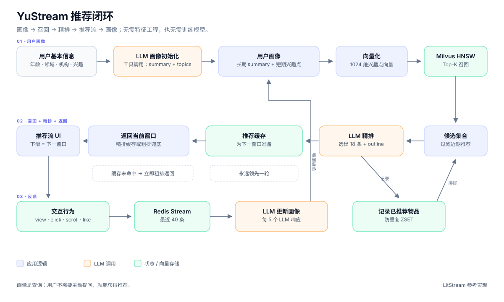
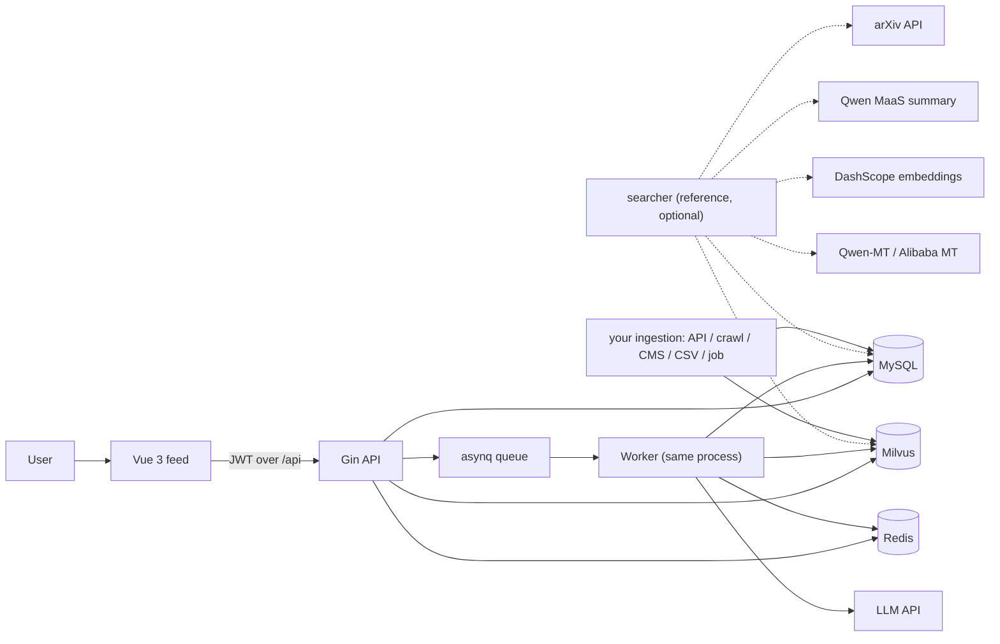
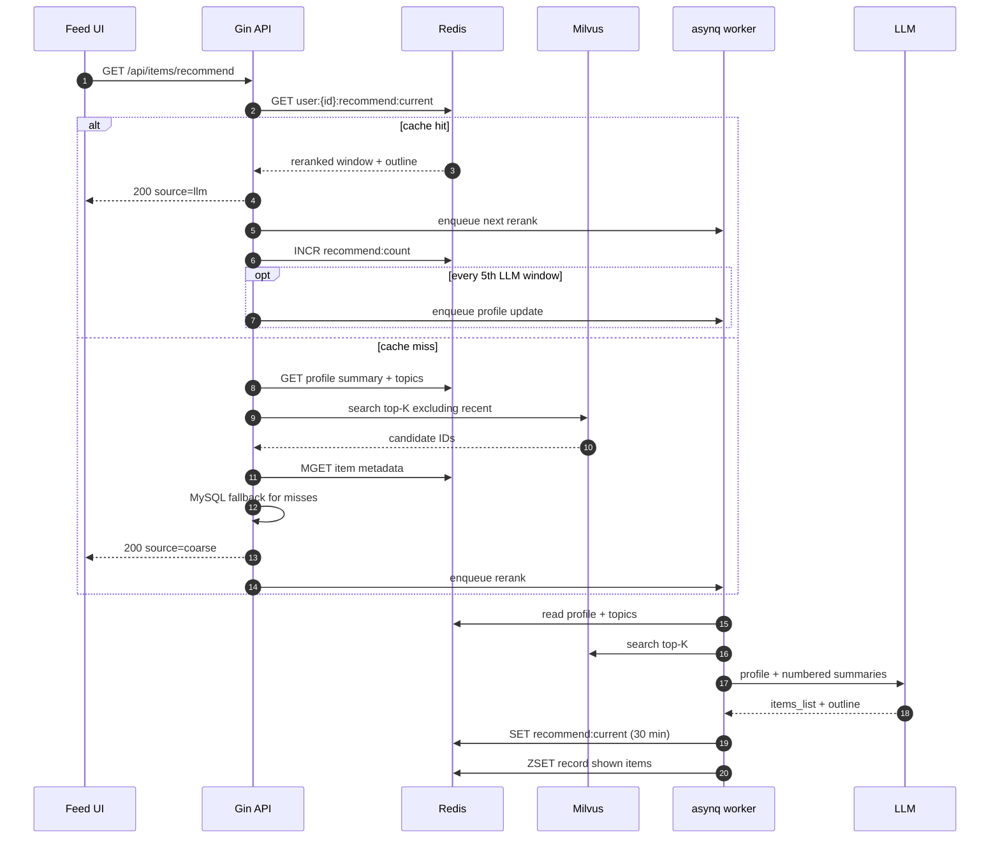

# 架构

[English](architecture.md) · [中文](architecture.zh-CN.md)

本文说明 YuStream 如何将文本画像转化为推荐流、状态存放在哪里，以及哪些取舍是有意为之。



## 1. 设计目标与非目标

### 目标

- **无需训练流水线。** 领域逻辑存在于提示词、物品 schema 和入库适配器中，而不是特征存储或训练好的模型里。
- **语义冷启动。** 新用户仅凭文本画像和已完成 embedding 的目录即可获得有用的推荐，无需历史交互。
- **有界的 feed 延迟。** 一次 feed 请求绝不能等待 LLM。当前窗口由缓存或向量召回提供；下一个窗口异步准备。
- **低成本适配。** 迁移到新的垂直领域主要意味着重写提示词、替换目录来源并重新 embedding。
- **单机友好。** 应用层是一个 Go 服务加一个静态前端。数据层（Milvus、MySQL、Redis）主导内存占用。

### 非目标

- 面向 Web 规模的检索（数十亿物品）或低于 100 ms 的 p99 排序。
- 广告竞价、出价或受收入约束的排序。
- 在行为数据和可测量的 CTR 充足时取代成熟的推荐系统。
- 保证 LLM 输出的事实正确性。精排器被限制为只能从提供的候选中选择，但提示词并不是证明。
- 开箱即用的多租户 SaaS。当前一个部署只服务一个垂直领域和一个 Milvus 集合。

## 2. 系统上下文



| 组件 | 角色 | 状态 |
| --- | --- | --- |
| Vue 3 SPA | 认证、引导、feed、画像、详情、交互采集 | 浏览器 localStorage 用于会话和展示偏好 |
| Gin API | 同步请求处理、认证、限流、缓存/召回读取、任务入队 | 无状态 |
| asynq worker | 画像生成/更新、精排 | 参考实现中与 API 同进程；共享服务 |
| MySQL | 用户、画像、物品元数据 | 持久化 |
| Redis | 缓存、交互流、推荐缓存、最近推荐 ZSET、队列 | 受 TTL 约束 / 由队列支撑 |
| Milvus | 仅 `id` + embedding 向量 | 持久化向量；元数据保留在 MySQL |
| searcher | 面向 arXiv 的**参考**离线生产者；可选 | 直接写入 MySQL 和 Milvus |
| 你的入库流程 | 任意来源和任意工具 | 必须将同一物品契约写入 MySQL 和 Milvus |

后端不使用独立的特征存储、模型服务器或向量元数据服务。它也不导入 searcher：只读取 MySQL 和 Milvus。这是主要的架构简化：**画像是查询，物品摘要是文档**。

### 2.1 物品契约

`searcher/` 是一个参考实现，不是必需组件。你可以通过官方 API、爬虫、CMS 导出、CSV、消息队列或内部批处理任务进行入库。运行时只要求以下链路：

```text
raw item information
      │  (any source and any tool)
      ▼
item semantic text
      │  (summary / enriched description / title + attributes)
      ▼
embedding vector
      │
      ├── MySQL: items row with the same id, display fields, and semantic text
      └── Milvus: (id, vec) with the same id
```

有三条规则使入库流水线保持兼容：

1. **相同 ID。** 写入 Milvus 的 MySQL `items.id` 必须与后端将加载的 ID 相同。在参考 searcher 中，MySQL 插入返回自增 ID，searcher 将该 ID 写入 Milvus。
2. **相同 embedding 空间。** searcher 和后端必须使用相同的 embedding 模型和 `VEC_DIM`。不同模型的向量不可比较。
3. **同一份语义文本。** 用于召回而 embedding 的文本应当是精排器看到的文本（或其忠实派生文本）。LitStream 对两者都使用 `items.summary`。

如果这些条件成立，后端不关心数据是如何到达的。参考实现参见[数据流水线](data-pipeline.zh-CN.md)，其他入库路径参见[扩展与优化](extending.zh-CN.md)。

## 3. 推荐闭环

### 3.1 画像初始化

首次使用时，用户提交一小组字段：

- 年龄、性别、职业、教育、所在地、组织
- 最多 10 个 `interesting_fields`

`user_summary:generate` 任务通过强制工具调用（`extract_user_profile`）调用 LLM，并获得两个字段：

| 字段 | 用途 | 使用位置 |
| --- | --- | --- |
| `summary` | 可读的自然语言画像：基本事实、长期话题、推断的信息需求以及不确定的需求 | 作为上下文传给精排器；在 UI 中展示 |
| `interest_topics` | 一份简短、刻意不稳定的当前话题列表 | 被 embedding，并作为**唯一**的召回查询 |

这种拆分是提示词设计的核心选择：

- **summary** 可以较长、细腻且带有推测性。它用于推理。
- **topics** 必须保持简短具体，因为每个 token 都会成为检索查询的一部分。更新提示词明确要求保持格式稳定，以便向量仍然可比。

画像存储在 MySQL（`users.summary`、`users.topics`）中，并缓存在 Redis 中。保存画像会使缓存的话题向量失效，以便下一次召回重新计算。

### 3.2 召回（粗排）

`fetchCandidates` 由同步兜底路径和异步精排器共享：

1. 读取 `summary` 和 `topics`（优先 Redis hash，回退 MySQL）。
2. 使用配置的 embedding 模型对 `topics` 做 embedding。向量缓存在 Redis 的 `vec:user:{id}` 下。
3. 使用 HNSW/L2 在 Milvus 中搜索可配置的 top-K，排除最近推荐过的物品。同步粗排路径请求 `LIMIT_TOP_K`（18）；异步精排器请求 `SEARCH_TOP_K`（100）。
4. 如果剩余结果少于请求的 top-K，则**不带**排除过滤器再次搜索，以避免 feed 饥饿。
5. 按 ID 加载物品元数据：先 Redis `MGET`，未命中的再查 MySQL，然后回填 Redis。

参考应用中的默认值：`SEARCH_TOP_K=100`、`LIMIT_TOP_K=18`、`VEC_DIM=1024`。

Milvus 仅存储 `(id, vec)`。所有过滤和展示字段都来自 MySQL/Redis。这使向量集合保持较小，并且无需重新 embedding 即可修改元数据。召回路径不知道也不关心物品来自 `searcher/` 还是你自己的加载器；它只看到物品契约。

### 3.3 精排（LLM 决策）

异步任务 `recommendation:generate` 运行精排器：

1. 获取最多 `SEARCH_TOP_K` 个候选。
2. 为候选编号，并将其**摘要**（而非完整摘要原文）传给 LLM。
3. LLM 接收画像摘要、兴趣话题和候选列表。
4. 强制工具调用返回：
   - `items_list`：所选物品的从 1 开始的索引
   - `outline`：对推荐集合的简短描述
5. 服务将索引映射回物品，进行边界检查，将已展示物品记录到最近推荐 ZSET 中，并将结果写入 Redis。

提示词要求多样性，而不仅仅是最大相似度，以减少信息茧房。LLM 只能从提供的索引中选择；不能凭空创造物品。

> **提示词大小警告。** 精排提示词包含每个候选的摘要。当 `SEARCH_TOP_K=100` 且摘要接近 500 token 的建议上限时，提示词可能变得很大。在扩大流量之前，降低 `SEARCH_TOP_K`、缩短摘要，或截断每个物品的文本。

### 3.4 交付：始终领先一个窗口

`GET /api/items/recommend` 有意保持**同步且不调用 LLM**：

```text
cache hit  -> return the previously reranked window  (source=llm)
             + enqueue the next rerank
             + increment the LLM-window counter

cache miss -> run vector recall now                   (source=coarse)
             + return immediately
             + enqueue a rerank for a later window
```

登录后的首次请求通常是粗排。等用户滚动到底部时，第一个精排窗口通常已经就绪，因此下一次请求会返回 `source=llm`。这就是“领先一个窗口”的延迟隐藏策略。

后果：

- 没有请求会等待 LLM；只要目录非空，feed 就始终有内容可展示。
- 如果用户滚动速度超过精排完成速度，同一个缓存窗口可能被再次返回。前端按物品 ID 去重，只追加新物品。
- 推荐缓存是**每个用户一个槽位**（`user:{id}:recommend:current`），而不是按窗口键控的历史记录。新的精排会覆盖前一个。代码中少数位置的注释仍描述按窗口的 `key`；实现是单槽位变体。
- 缓存 TTL 为 `RECOMMEND_TTL`（默认 30 分钟）。过期后，下一个请求回退到粗排。

### 3.5 反馈与画像演化

前端将交互上报到 `POST /api/interactions`。每个事件追加到 Redis Stream（`user:{id}:interactions`，最多 40 条，默认 14 天 TTL）。

| 类型 | 含义 | `target` | `detail` | `long_ts` |
| --- | --- | --- | --- | --- |
| `click` | 打开卡片或点击原始链接 | 该物品 | `card` 或 `link` | 0 |
| `scroll` | 浏览了一个推荐窗口 | 空 | 窗口的 `outline` | 停留时间，单位**秒**，上限 5 分钟 |
| `like` | 物品被点赞 | 该物品 | 空 | 0 |
| `view` | 详情停留事件 | 该物品 | 空 | 停留时间，单位**秒**，上限 3 分钟 |

LitStream UI 会发出全部四种类型。`view` 在详情弹窗关闭时结算；计时器位于 `ui` store 中，而不是 `ItemDetailPanel.vue` 中。`scroll` 仅对 `source=llm` 的窗口发出，因为粗排窗口没有 LLM 生成的 `outline` 可用于描述它。

画像更新是**增量式**的：

1. 每第五次缓存命中响应（`source=llm`），`GetRecommend` 会入队 `user_summary:update`。
2. worker 读取交互流，并在 Redis 指针处将其拆分为“新”和“历史”。
3. LLM 接收旧画像、历史交互和新交互。
4. 成功后，写回新的 `summary` 和 `topics`，删除话题向量，并推进指针。

指针仅在成功写入后推进。因此，失败的 LLM 调用会让这些交互保留给下一次尝试，而不是静默跳过它们。

### 3.6 防重复

`user:{id}:recentlyrecommended` 是一个 Redis ZSET，其**分值是物品被展示后经过的精排轮数**：

- 每次精排时，所有现有成员的分值加 1。
- 分值 `>= RECS_WINDOW` 的成员会被移除。
- 新展示的物品以分值 0 插入。
- 召回会排除分值在 `0 .. RECS_WINDOW-1` 的成员。

因此 `RECS_WINDOW=10` 表示“最近 10 轮精排”，而不是“最近 10 个物品”。当 `LIMIT_TOP_K=18` 时，最多排除约 180 个物品。如果召回数量低于 `SEARCH_TOP_K`，服务会有意不带过滤器重试；因此可能出现重复物品，客户端会对其进行去重。

## 4. 请求生命周期



如果画像尚不存在，API 返回 `200`、空列表和 `source=empty`，并异步入队画像生成。它不会因为画像缺失而返回 5xx。

## 5. 数据模型

### MySQL

`users`（GORM `domain.User`）：

| 列 | 说明 |
| --- | --- |
| `id` | 主键 |
| `username` | 展示昵称，2–15 个非空格字符 |
| `email` | 唯一登录标识 |
| `password` | bcrypt 哈希 |
| `age`, `gender`, `job`, `education`, `location`, `organization` | 画像输入字段 |
| `interesting_fields` | JSON 数组，最多 10 个 |
| `summary` | LLM 生成的自然语言画像 |
| `topics` | LLM 生成的短期兴趣话题（召回查询） |

`items`（GORM `domain.Item`）：

| 列 | 说明 |
| --- | --- |
| `id` | 自增，同时也是 Milvus 主键 |
| `title`, `web_source`, `url`, `publish_date` | 元数据；`url` 是 arXiv 的去重键 |
| `authors`, `fields`, `keywords` | JSON 数组 |
| `abstract` | 原始摘要 |
| `is_chinese`, `title_chinese`, `abstract_chinese` | 翻译状态和文本 |
| `summary` | 经过增强、可直接用于 embedding 的摘要；也作为“推荐理由”展示 |

### Redis

| 键 | 类型 | TTL（默认） | 用途 |
| --- | --- | --- | --- |
| `user:{id}` | Hash | 72 h | 画像缓存：基本字段、`summary`、`topics`、兴趣 |
| `email:{email}` | String | 72 h | 邮箱 → 用户 ID 查询 |
| `vec:user:{id}` | 二进制字符串 | 72 h | 缓存的 float32 话题向量；画像变化时删除 |
| `user:{id}:interactions` | Stream | 14 天 | 交互事件，上限 40 条 |
| `user:{id}:interactions:ptr` | String | 14 天 | 最后处理的 stream ID |
| `user:{id}:recommend:current` | String (JSON) | 30 分钟 | 当前精排窗口 + outline |
| `user:{id}:recommend:count` | String | — | 计数器；到 5 时重置以触发画像更新 |
| `user:{id}:recentlyrecommended` | ZSET | — | 防重复窗口；分值 = 自展示以来经过的轮数 |
| `item:{id}` | String (JSON) | 168 h | 物品元数据缓存 |
| `rl:*` | String | 按限流器 | 登录/注册/邮件限流 |

### Milvus

| 字段 | 类型 | 说明 |
| --- | --- | --- |
| `id` | `Int64`，主键 | 与 `items.id` 值相同；不使用自动 ID |
| `vec` | `FloatVector(VEC_DIM)` | `items.summary` 的 embedding |

索引：HNSW、L2、`M=16`、`efConstruction=64`。搜索 `ef` 至少为 `2 × topK`。集合在启动时以幂等方式创建并加载。

## 6. 故障处理

| 故障 | 行为 | 用户影响 |
| --- | --- | --- |
| 精排期间 LLM 超时 / 5xx | asynq 最多重试 3 次；当前缓存/粗排结果保留 | feed 继续工作；LLM 窗口可能延迟 |
| 画像更新期间 LLM 故障 | 任务重试；交互指针**不**推进 | 画像更新延迟，交互不会丢失 |
| 推荐缓存未命中 / 过期 | 同步粗排召回 | 窗口个性化程度略低；无需等待 |
| 缓存上的 Redis 读取错误 | 记录日志；回退到粗排 | feed 继续 |
| Redis 交互写入错误 | 请求返回 500；前端以 fire-and-forget 方式发送交互 | 可能静默丢失一条交互 |
| 队列不可用 | 精排/画像入队失败；API 仍尽可能返回当前窗口 | 个性化停止推进，直到 Redis 恢复 |
| Milvus 不可用 / 集合为空 | 召回错误向上传播为 500 | feed 失败，直到 Milvus 健康并完成数据填充 |
| MySQL 不可用 | 画像/物品加载错误向上传播 | 认证和 feed 失败 |
| 画像缺失 | `200` + 空列表 + 入队生成 | 用户先看到空状态，然后看到画像 |
| 重复入队 | asynq `Unique` 将重复视为成功 | 不会重复执行工作 |
| 服务重启 | Redis 队列和 TTL 状态保留；进行中的 HTTP 请求不保留 | 最多多一个窗口的延迟 |

## 7. 一致性与并发

- **处处 cache-aside。** 读取先尝试 Redis，回退到 MySQL/Milvus，然后回填。
- **Single-flight embedding。** 同一用户的并发请求共享一次 embedding 调用；第一个调用者的 context 被分离，因此取消不会让等待者失败。
- **原子化更新最近推荐。** 一个 Lua 脚本在一次往返中增加分值、裁剪窗口并插入新成员。
- **成功后再推进指针。** 交互指针仅在画像写入完成后推进。
- **事务化画像写入。** `SaveSummaryAndTopics` 使用 Redis 事务 pipeline 更新 `summary`/`topics` 并删除向量，然后写入 MySQL。
- **先 MySQL，后缓存。** 画像编辑先写 MySQL，再修补 Redis。缓存失败不会回滚 MySQL；下一次读取会从 MySQL 自愈。
- **最终一致的画像更新。** 在增量更新生效之前，精排器可能再使用旧画像运行一次。这对 feed 来说可以接受，并且避免了阻塞交付。
- **不强制每个用户只有一个写入者。** 在多实例部署中，两个 worker 可能并发地对同一用户进行精排；缓存采用最后写入者胜出。asynq `Unique` 会减少这种情况，但不能消除它。

## 8. 安全与隐私

- 密码使用 bcrypt。登录方式为邮箱 + 密码。
- JWT 使用 HS256。访问令牌在 `ACCESS_TOKEN_EXPIRE_HOUR` 后过期（默认 1 小时）；刷新令牌会签发，但**未实现刷新端点**——客户端存储刷新令牌但不使用它。
- 公开认证端点按 IP 限流：
  - 登录：10 次/分钟
  - 注册：5 次/分钟
  - 忘记密码：100 次/5 分钟
  - 验证邮件：10 次/天
- API 没有 CORS 中间件。前端应通过反向代理以同源方式提供，或在开发时由 Vite 代理。
- 画像和交互可能包含个人数据。它们会被发送到配置的 LLM 提供方用于生成/精排。在生产使用前，请查看提供方的数据保留条款。
- Redis 和 MySQL 包含画像数据，缓存有 TTL，但 MySQL 中的行是持久的。请为用户数据定义删除策略。
- `.env` 包含 API 密钥和 JWT secret。它已被 git 忽略；`.env.example` 是模板，必须保持脱敏。

## 9. 已知限制

以下是当前实现的事实，而不是路线图承诺：

1. **硬编码的 LLM 端点。** 后端聊天客户端向 `https://api.deepseek.com/chat/completions` 发送请求；searcher 的摘要客户端向 Qwen MaaS 端点发送请求。切换提供方需要修改代码，而不仅仅是 `.env`。
2. **提示词是 Go 常量。** 修改提示词需要重新构建/重启后端。没有提示词注册表或热重载。
3. **每个部署一个垂直领域。** 单个 `MILVUS_COLLECTION_NAME` 和一套提示词。未实现多垂直领域路由。
4. **每个用户一个推荐缓存槽位。** 没有按窗口的历史记录，尽管过时的注释仍提到 `key`。
5. **没有刷新令牌路由。** SPA 目前未使用刷新令牌。
6. **没有离线评估工具。** 目前仓库中没有标注的相关性集合、NDCG 脚本或基准结果。
7. **精排器提示词增长。** 候选数量 × 摘要长度是 token 成本的主要杠杆。
8. **Milvus 集合为空并不等于空状态。** 召回会返回错误，最终表现为 500。请先填充目录。
9. **仅客户端去重。** 服务端不知道客户端已经渲染的完整物品集合。
10. **没有审核或内容安全层。** 在向公众用户开放新的垂直领域之前，请添加一层。
11. **没有多租户隔离。** 所有用户共享一个目录和一个集合。
12. **searcher 是 arXiv 专用的参考实现，不是通用连接器。** 它演示了入库契约；其他垂直领域应使用适合它的任何来源和工具。

## 10. 扩展点

| 需求 | 修改位置 |
| --- | --- |
| 新的垂直领域提示词 | [`backend/llm/prompt.go`](../backend/llm/prompt.go)，工具 schema 位于 [`backend/llm/invoking.go`](../backend/llm/invoking.go) |
| 新的物品字段 | `backend/domain/models_domain.go`、你的入库模型、`frontend/src/utils/format.js` |
| 新的目录来源 | 任意入库路径。保持物品契约；以 `searcher/` 为参考，或编写自己的加载器 |
| 不同的 embedding 模型 | `EMBEDDING_MODEL_*`、`VEC_DIM`，然后重建/重新 embedding 集合 |
| 不同的精排器 | `ItemService.recommend`、`LLMInvoking.Recommend`、`BuildToolRecommend` |
| 不同的交互策略 | `InteractionService`、`InteractionRepository.FetchDelta`、`PromptUpdateUS` |
| 多垂直领域路由 | 每个垂直领域一个集合 + 每个租户一套提示词；未内置 |
| 实时画像更新 | 用 `InteractionService` 中的事件驱动 debounce 替换每 5 次缓存命中触发一次的逻辑 |
| 框架级优化 | 参见[扩展与优化](extending.zh-CN.md) |

如需按步骤操作的垂直领域复用方案，参见[垂直领域复用指南](reuse-guide.zh-CN.md)。如需框架变更，参见[扩展与优化](extending.zh-CN.md)。
