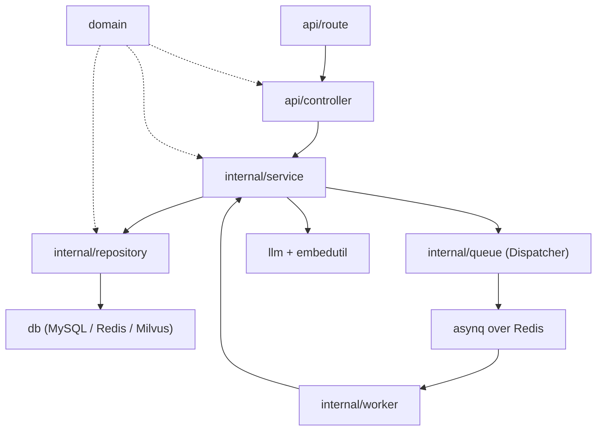

# Backend structure

[English](backend-structure.md) · [中文](backend-structure.zh-CN.md)

The backend is a Go 1.26 service built around one rule: **business decisions live in `service`, and everything else is a thin adapter around it.**

## 1. Directory map

```text
backend/
├── cmd/
│   └── main.go                 # process entry: NewEnv -> NewApp -> StartServer
├── bootstrap/
│   ├── env.go                  # reads .env with Viper
│   └── app.go                  # composition root: DBs, clients, repos, services, routes, worker
├── api/
│   ├── route/                  # URL registration, public/private groups
│   ├── controller/             # HTTP binding/response only
│   └── middleware/             # JWT, rate limit, request logging
├── domain/
│   ├── models_domain.go        # User, Item, Interaction, Redis hash helpers
│   ├── request_domain.go       # request structs + validation tags
│   ├── response_domain.go      # response DTOs
│   ├── env_domain.go           # typed .env fields
│   ├── rediskey_domain.go      # every Redis key is constructed here
│   └── jwt_domain.go           # JWT claims
├── db/
│   ├── database.go             # AllDatabases aggregate
│   ├── mysql_db.go             # GORM + pool + AutoMigrate
│   ├── redis_db.go             # go-redis client
│   ├── milvus_db.go            # collection create/load, HNSW search
│   └── wq_db.go                # asynq client
├── internal/
│   ├── service/                # business orchestration (sync vs async)
│   ├── repository/             # MySQL/Redis/Milvus data access
│   ├── queue/                  # task types, payloads, Dispatcher
│   ├── worker/                 # asynq handler -> service call
│   └── util/
│       ├── embedutil/          # embeddings + Redis vector cache + singleflight
│       ├── mailutil/           # Alibaba Cloud DirectMail
│       └── tokenutil/          # JWT create/parse
├── llm/
│   ├── prompt.go               # all recommendation/profile prompts
│   └── invoking.go             # tool schemas + LLM calls + response parsing
├── pkg/
│   ├── llm.go                  # minimal OpenAI-style chat client (DeepSeek URL)
│   ├── my_error.go             # MyError + HTTP status constants
│   ├── binding_validator.go    # custom password/username/email/code validators
│   └── mylog/                  # zerolog, GORM logger, asynq trace middleware
├── test/                       # scratch/integration programs (not a production package)
├── Dockerfile                  # multi-stage build, non-root, alpine runtime
├── .air.toml                   # local hot reload
└── go.mod / go.sum
```

The backend never imports `searcher/`. It reads MySQL and Milvus and knows nothing about how those rows/vectors were produced. The searcher is one optional reference producer; your loader can be any language or service, as long as it writes the item contract described in [Data pipeline](data-pipeline.md#the-data-contract).

## 2. Layer rules



| Layer | May do | Must not do |
| --- | --- | --- |
| `route` | Group URLs, attach middleware, wire controllers | Business logic, DB access |
| `controller` | Bind/validate JSON, read `x-user-id`, map `MyError` to HTTP | Call repositories, enqueue tasks, call LLMs |
| `service` | Decide sync vs async, orchestrate repositories/LLM/queue, own use-cases | Write SQL/Redis commands directly, know about Gin |
| `repository` | Pure data access, cache-aside, key construction | Call LLMs, enqueue tasks, make product decisions |
| `worker` | Decode task payload, call one service method | Business logic, direct DB access |
| `queue` | Define task types/payloads and the producer API | Execute business logic |
| `llm` | Prompt construction, tool schema, provider call, parsing | Persist data |
| `domain` | Entities, DTOs, env shape, key names | Depend on asynq/Gin/Milvus SDK |
| `bootstrap` | Build the object graph, start HTTP + worker | Hide business rules |

The worker and HTTP server share the same service instances. That is why the worker never duplicates business logic: it is a transport adapter, exactly like a controller.

## 3. Startup sequence

`cmd/main.go`:

```go
app := bootstrap.NewApp(bootstrap.NewEnv())
defer app.CloseAllDBConnection()
app.StartServer() // starts the asynq worker in a goroutine, then Gin
```

`bootstrap.NewApp`:

1. Initialize zerolog.
2. Register custom validators.
3. Open MySQL, Redis, asynq client, Milvus (create/load collection if needed).
4. Build the LLM invoker and embedder.
5. Build repositories (`users`, `interactions`, `items`, recommendation cache, mail cache).
6. Build services (`UserService`, `ItemService`, `InteractionService`).
7. Register routes.
8. `StartServer` starts the asynq worker (`Concurrency: 50`) and then `gin.Run`.

Milvus startup is the only hard dependency that can block. `InitMilvus` gives it a 15-second budget and creates the collection/index idempotently.

## 4. HTTP request flow

### Recommendation

```text
GET /api/items/recommend
  -> JwtAuthMiddleware
  -> ItemsController.GetItemsRecommend
  -> ItemService.GetRecommend
       -> RecommendCache.Get
       -> (hit)  return cached items + enqueue next rerank + maybe enqueue profile update
       -> (miss) fetchCandidates:
            UserRepository.GetSummaryAndTopics
            Embedding.GetVec
            ItemRepository.RecentExcludes
            ItemRepository.SearchVec
            ItemRepository.LoadMany
          return coarse items + enqueue rerank
```

Files:

- [`api/controller/items_controller.go`](../backend/api/controller/items_controller.go)
- [`internal/service/item_service.go`](../backend/internal/service/item_service.go)
- [`internal/repository/item_repository.go`](../backend/internal/repository/item_repository.go)
- [`internal/repository/recommend_cache.go`](../backend/internal/repository/recommend_cache.go)
- [`internal/repository/user_repository.go`](../backend/internal/repository/user_repository.go)
- [`internal/util/embedutil/embedutil.go`](../backend/internal/util/embedutil/embedutil.go)

### Profile

```text
POST /api/users/info   -> FillInfo  -> MySQL + cache only (no profile task)
PUT  /api/users/info   -> UpdateInfo -> MySQL + cache + enqueue user_summary:new_info
PUT  /api/users/summary-> EnqueueProfileRegeneration -> user_summary:generate
POST /api/users/summary-> EnqueueIncrementalProfileUpdate -> user_summary:update
GET  /api/users/info   -> GetProfile -> ShowProfileResponse
```

The first onboarding flow uses `POST` to save fields, then the frontend explicitly calls `PUT /users/summary` to generate the profile. Editing from "My profile" uses `PUT /users/info`, which enqueues the field-aware update.

### Interactions

```text
POST /api/interactions
  -> InteractionsController.AddNewInteraction
  -> InteractionService.RecordInteraction
  -> InteractionRepository.Append (Redis XADD + TTL)
```

No task is enqueued per interaction. Profile updates are triggered by the recommendation path (every fifth cache-hit response) or manually via `POST /users/summary`.

## 5. Async tasks

| Task type | Producer | Handler | Service method | Purpose |
| --- | --- | --- | --- | --- |
| `recommendation:generate` | `ItemService.GetRecommend` | `ItemWorker.HandleGenerateRecommendation` | `ItemService.GenerateRecommendation` | Rerank candidates, cache next window |
| `user_summary:generate` | Empty-profile path, `PUT /users/summary` | `UserWorker.HandleGenerateUS` | `UserService.GenerateProfile` | Full profile regeneration |
| `user_summary:update` | Every 5th LLM window, `POST /users/summary` | `UserWorker.HandleUpdateUS` | `UserService.IncrementalProfileUpdate` | Consume interactions, update profile |
| `user_summary:new_info` | `PUT /users/info` | `UserWorker.HandleUpdateUSWithNewInfo` | `UserService.ReProfileWithNewInfo` | Update profile after field changes |

All tasks use `asynq.MaxRetry(3)` and `asynq.Unique(...)`. A duplicate enqueue is treated as success, not an error. Payloads carry a `request_id` header for trace correlation.

To add a task:

1. Add a type constant + payload struct in `internal/queue/tasks.go`.
2. Add `newXxxTask` and an `EnqueueXxx` method on `Dispatcher`.
3. Add a handler in the relevant worker and register it in `RegisterXxxTasks`.
4. Add the execution method to the service.

## 6. Data access patterns

| Pattern | Where | Why |
| --- | --- | --- |
| Cache-aside | `UserRepository`, `ItemRepository` | Redis first, MySQL fallback, best-effort backfill |
| Read-through vector cache | `embedutil.GetVec` | Avoid re-embedding the same topics on every request |
| Single-flight | `embedutil.DoCtx` | One embedding call per user under concurrency; detach the first caller's cancellation |
| Atomic ZSET update | `ItemRepository.recsUpdateScript` | Increment ages, trim, insert new items in one Lua round trip |
| Stream + pointer | `InteractionRepository` | Bounded interaction history; pointer advances only after success |
| Transactional pipeline | `UserRepository.SaveSummaryAndTopics` | Update summary/topics and delete the vector atomically in Redis |
| MySQL-first write | `UserRepository` | Durable source of truth; cache failure does not roll back MySQL |

## 7. Prompts and LLM parsing

All prompts are in [`llm/prompt.go`](../backend/llm/prompt.go); tool schemas and parsing are in [`llm/invoking.go`](../backend/llm/invoking.go).

| Function | Prompt | Output |
| --- | --- | --- |
| `GenerateUserProfile` | `PromptGenerateUS` | `summary`, `interest_topics` |
| `UpdateUserProfile` | `PromptUpdateUS` | Updated `summary`, `interest_topics` |
| `UpdateWithNewInfo` | `PromptUpdateWithNewInfo` | Updated `summary`, `interest_topics` |
| `Recommend` | `PromptRecommend`, `PromptRecommendUser` | `items_list` (1-based indices), `outline` |

The LLM is forced into a tool call (`tool_choice`), and the code parses `tool_calls[0].function.arguments`. If the model returns an out-of-range index, it is skipped with a warning; the window can be smaller than `LIMIT_TOP_K`.

`pkg/llm.go` is a deliberately small OpenAI-style client. It currently hardcodes the DeepSeek endpoint, uses `temperature=1`, `max_tokens=4096`, disables thinking, and sets a 60-second HTTP timeout.

## 8. Error and logging conventions

- Service methods return `pkg.MyError{Code, Kind, Msg}` for expected business errors.
- Controllers return `{"kind": "...", "msg": "..."}`; validation errors may put a field map in `msg`.
- Repository errors are wrapped with context; service logs and maps them.
- Logs carry a request ID from the Gin middleware or asynq task header.
- The frontend treats 401 specially (clear session) and otherwise displays `msg`.

## 9. Testing and local iteration

- `go build ./cmd` is the fastest compile check for the service.
- `go test ./internal/...` runs package tests that do not need the scratch `test/` programs. The `backend/test/` directory contains integration/scratch programs that expect live MySQL, Redis, or Milvus; `go test ./...` may try to run them and fail without those services.
- `.air.toml` supports hot reload with `air` if installed.
- `gofmt` and `go vet` are expected before a PR.

## 10. Known rough edges

These are visible in the current code and are useful to know before contributing:

1. **Hardcoded provider endpoints.** `pkg/llm.go` targets DeepSeek; changing providers needs a base URL/auth refactor.
2. **Prompts are compile-time constants.** No prompt versioning or hot reload.
3. **One recommendation cache slot per user.** `RecommendCache` uses `user:{id}:recommend:current`; several comments still mention a per-window `key` that no longer exists.
4. **Stale comments around profile updates.** `InteractionService` says updates are manual only, but `GetRecommend` enqueues one every fifth cache-hit response.
5. **Empty Milvus is an error, not an empty feed.** `MilvusDB.SearchVec` returns an error when there are no results.
6. **No refresh-token endpoint.** Tokens are issued but the refresh flow is not implemented.
7. **Single vertical per process.** One collection and one prompt set; no tenant routing.
8. **`ALIYUN_EMAIL` / `ALIYUN_FROM` are declared but unused** by the current DirectMail implementation.
9. **The worker is in the HTTP process.** It is logically decoupled (`StartWorker`), but a separate `cmd/worker` entry does not exist yet.
10. **`test/` is a `package main` scratch area.** It is not a normal test package and can break `go build ./...`.
11. **The reranker prompt includes every candidate summary.** `SEARCH_TOP_K=100` can be expensive; tune it per vertical.
12. **No metrics/tracing exporter.** Logs and request IDs are the current observability surface.
13. **The catalog boundary is implicit.** The backend assumes `items` + Milvus are populated correctly; there is no ingestion health check. A bad loader shows up as an empty/500 feed, not a startup error.

If you fix one of these, update this list and the corresponding section in [Architecture](architecture.md#9-known-limitations). For framework-level changes, see [Extending and optimizing](extending.md).
