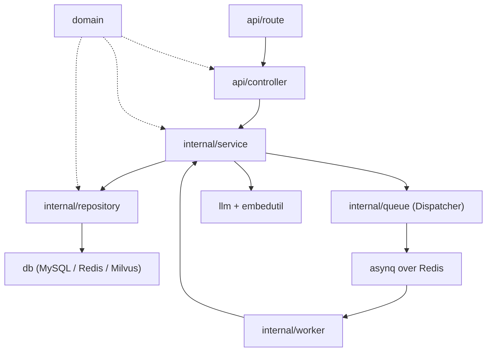

# 后端结构

[English](backend-structure.md) · [中文](backend-structure.zh-CN.md)

后端是一个围绕单一规则构建的 Go 1.26 服务：**业务决策位于 `service`，其他一切则都是围绕它的薄适配层。**

## 1. 目录结构

```text
backend/
├── cmd/
│   └── main.go                 # 进程入口：NewEnv -> NewApp -> StartServer
├── bootstrap/
│   ├── env.go                  # 使用 Viper 读取 .env
│   └── app.go                  # 组合根：数据库、客户端、仓储、服务、路由、worker
├── api/
│   ├── route/                  # URL 注册，公开/私有分组
│   ├── controller/             # 仅负责 HTTP 绑定/响应
│   └── middleware/             # JWT、限流、请求日志
├── domain/
│   ├── models_domain.go        # User、Item、Interaction、Redis 哈希辅助函数
│   ├── request_domain.go       # 请求结构体 + 校验标签
│   ├── response_domain.go      # 响应 DTO
│   ├── env_domain.go           # 有类型的 .env 字段
│   ├── rediskey_domain.go      # 所有 Redis key 都在这里构造
│   └── jwt_domain.go           # JWT claims
├── db/
│   ├── database.go             # AllDatabases 聚合
│   ├── mysql_db.go             # GORM + 连接池 + AutoMigrate
│   ├── redis_db.go             # go-redis 客户端
│   ├── milvus_db.go            # collection 创建/加载，HNSW 检索
│   └── wq_db.go                # asynq 客户端
├── internal/
│   ├── service/                # 业务编排（同步 vs 异步）
│   ├── repository/             # MySQL/Redis/Milvus 数据访问
│   ├── queue/                  # 任务类型、负载、Dispatcher
│   ├── worker/                 # asynq handler -> 服务调用
│   └── util/
│       ├── embedutil/          # 嵌入 + Redis 向量缓存 + singleflight
│       ├── mailutil/           # 阿里云 DirectMail
│       └── tokenutil/          # JWT 创建/解析
├── llm/
│   ├── prompt.go               # 所有推荐/画像提示词
│   └── invoking.go             # 工具 schema + LLM 调用 + 响应解析
├── pkg/
│   ├── llm.go                  # 极简 OpenAI 风格聊天客户端（DeepSeek URL）
│   ├── my_error.go             # MyError + HTTP 状态码常量
│   ├── binding_validator.go    # 自定义密码/用户名/邮箱/验证码校验器
│   └── mylog/                  # zerolog、GORM 日志器、asynq 追踪中间件
├── test/                       # 临时/集成程序（不是生产包）
├── Dockerfile                  # 多阶段构建，非 root，alpine 运行时
├── .air.toml                   # 本地热重载
└── go.mod / go.sum
```

后端从不导入 `searcher/`。它读取 MySQL 与 Milvus，对这些行/向量是如何产生的毫不知情。searcher 只是一个可选的参考生产者；你的加载器可以是任何语言或服务，只要它写入 [数据管道](data-pipeline.zh-CN.md#数据契约) 中描述的物品契约。

## 2. 分层规则



| 分层 | 可以做 | 禁止做 |
| --- | --- | --- |
| `route` | 对 URL 分组、挂载中间件、装配 controller | 业务逻辑、数据库访问 |
| `controller` | 绑定/校验 JSON、读取 `x-user-id`、把 `MyError` 映射为 HTTP | 调用仓储、入队任务、调用 LLM |
| `service` | 决定同步还是异步、编排仓储/LLM/队列、拥有用例 | 直接写 SQL/Redis 命令、感知 Gin |
| `repository` | 纯数据访问、cache-aside、构造 key | 调用 LLM、入队任务、做产品决策 |
| `worker` | 解码任务负载、调用一个 service 方法 | 业务逻辑、直接访问数据库 |
| `queue` | 定义任务类型/负载与生产者 API | 执行业务逻辑 |
| `llm` | 构建提示词、工具 schema、调用供应商、解析响应 | 持久化数据 |
| `domain` | 实体、DTO、env 结构、key 名称 | 依赖 asynq/Gin/Milvus SDK |
| `bootstrap` | 构建对象图、启动 HTTP + worker | 隐藏业务规则 |

worker 与 HTTP 服务器共享同一批 service 实例。因此 worker 从不重复业务逻辑：它就是一个传输适配器，与 controller 完全一样。

## 3. 启动顺序

`cmd/main.go`：

```go
app := bootstrap.NewApp(bootstrap.NewEnv())
defer app.CloseAllDBConnection()
app.StartServer() // starts the asynq worker in a goroutine, then Gin
```

`bootstrap.NewApp`：

1. 初始化 zerolog。
2. 注册自定义校验器。
3. 打开 MySQL、Redis、asynq 客户端、Milvus（按需创建/加载 collection）。
4. 构建 LLM 调用器与嵌入器。
5. 构建仓储（`users`、`interactions`、`items`、推荐缓存、邮件缓存）。
6. 构建服务（`UserService`、`ItemService`、`InteractionService`）。
7. 注册路由。
8. `StartServer` 启动 asynq worker（`Concurrency: 50`），然后执行 `gin.Run`。

Milvus 启动是唯一可能阻塞的硬依赖。`InitMilvus` 为它预留 15 秒预算，并以幂等方式创建 collection/索引。

## 4. HTTP 请求流程

### 推荐

```text
GET /api/items/recommend
  -> JwtAuthMiddleware
  -> ItemsController.GetItemsRecommend
  -> ItemService.GetRecommend
       -> RecommendCache.Get
       -> (hit)  返回缓存的物品 + 入队下一次精排 + 可能入队画像更新
       -> (miss) fetchCandidates:
            UserRepository.GetSummaryAndTopics
            Embedding.GetVec
            ItemRepository.RecentExcludes
            ItemRepository.SearchVec
            ItemRepository.LoadMany
          返回粗排物品 + 入队精排
```

相关文件：

- [`api/controller/items_controller.go`](../backend/api/controller/items_controller.go)
- [`internal/service/item_service.go`](../backend/internal/service/item_service.go)
- [`internal/repository/item_repository.go`](../backend/internal/repository/item_repository.go)
- [`internal/repository/recommend_cache.go`](../backend/internal/repository/recommend_cache.go)
- [`internal/repository/user_repository.go`](../backend/internal/repository/user_repository.go)
- [`internal/util/embedutil/embedutil.go`](../backend/internal/util/embedutil/embedutil.go)

### 画像

```text
POST /api/users/info   -> FillInfo  -> MySQL + 仅缓存（无画像任务）
PUT  /api/users/info   -> UpdateInfo -> MySQL + 缓存 + 入队 user_summary:new_info
PUT  /api/users/summary-> EnqueueProfileRegeneration -> user_summary:generate
POST /api/users/summary-> EnqueueIncrementalProfileUpdate -> user_summary:update
GET  /api/users/info   -> GetProfile -> ShowProfileResponse
```

首次引导流程使用 `POST` 保存字段，随后前端显式调用 `PUT /users/summary` 生成画像。从「我的画像」进入编辑时使用 `PUT /users/info`，它会入队感知字段变化的更新任务。

### 交互

```text
POST /api/interactions
  -> InteractionsController.AddNewInteraction
  -> InteractionService.RecordInteraction
  -> InteractionRepository.Append (Redis XADD + TTL)
```

每次交互都不会入队任务。画像更新由推荐路径触发（每第五次缓存命中响应），或通过 `POST /users/summary` 手动触发。

## 5. 异步任务

| 任务类型 | 生产者 | 处理器 | 服务方法 | 用途 |
| --- | --- | --- | --- | --- |
| `recommendation:generate` | `ItemService.GetRecommend` | `ItemWorker.HandleGenerateRecommendation` | `ItemService.GenerateRecommendation` | 精排候选，缓存下一个窗口 |
| `user_summary:generate` | 空画像路径、`PUT /users/summary` | `UserWorker.HandleGenerateUS` | `UserService.GenerateProfile` | 全量画像重新生成 |
| `user_summary:update` | 每第五个 LLM 窗口、`POST /users/summary` | `UserWorker.HandleUpdateUS` | `UserService.IncrementalProfileUpdate` | 消费交互，更新画像 |
| `user_summary:new_info` | `PUT /users/info` | `UserWorker.HandleUpdateUSWithNewInfo` | `UserService.ReProfileWithNewInfo` | 字段变更后更新画像 |

所有任务都使用 `asynq.MaxRetry(3)` 与 `asynq.Unique(...)`。重复入队被视为成功而非错误。负载携带 `request_id` 头部用于追踪关联。

新增一个任务：

1. 在 `internal/queue/tasks.go` 中添加类型常量 + 负载结构体。
2. 在 `Dispatcher` 上添加 `newXxxTask` 与 `EnqueueXxx` 方法。
3. 在相应 worker 中添加处理器，并在 `RegisterXxxTasks` 中注册。
4. 在 service 中添加执行方法。

## 6. 数据访问模式

| 模式 | 位置 | 原因 |
| --- | --- | --- |
| Cache-aside | `UserRepository`、`ItemRepository` | 先查 Redis，回退 MySQL，尽力回填 |
| 读穿透向量缓存 | `embedutil.GetVec` | 避免每次请求都重新嵌入相同主题 |
| Single-flight | `embedutil.DoCtx` | 并发下每个用户只发起一次嵌入调用；分离第一个调用者的取消 |
| 原子 ZSET 更新 | `ItemRepository.recsUpdateScript` | 在一次 Lua 往返中递增 age、裁剪、插入新物品 |
| Stream + 指针 | `InteractionRepository` | 交互历史有界；指针仅在成功后推进 |
| 事务式 pipeline | `UserRepository.SaveSummaryAndTopics` | 在 Redis 中原子地更新 summary/topics 并删除向量 |
| MySQL 优先写入 | `UserRepository` | 持久化的真相来源；缓存失败不会回滚 MySQL |

## 7. 提示词与 LLM 解析

所有提示词都在 [`llm/prompt.go`](../backend/llm/prompt.go)；工具 schema 与解析在 [`llm/invoking.go`](../backend/llm/invoking.go)。

| 函数 | 提示词 | 输出 |
| --- | --- | --- |
| `GenerateUserProfile` | `PromptGenerateUS` | `summary`、`interest_topics` |
| `UpdateUserProfile` | `PromptUpdateUS` | 更新后的 `summary`、`interest_topics` |
| `UpdateWithNewInfo` | `PromptUpdateWithNewInfo` | 更新后的 `summary`、`interest_topics` |
| `Recommend` | `PromptRecommend`、`PromptRecommendUser` | `items_list`（从 1 开始的索引）、`outline` |

LLM 被强制发起工具调用（`tool_choice`），代码解析 `tool_calls[0].function.arguments`。如果模型返回越界索引，会被跳过并给出警告；窗口可能小于 `LIMIT_TOP_K`。

`pkg/llm.go` 是一个刻意保持小体积的 OpenAI 风格客户端。它目前硬编码 DeepSeek 端点，使用 `temperature=1`、`max_tokens=4096`，禁用 thinking，并设置 60 秒 HTTP 超时。

## 8. 错误与日志约定

- Service 方法对预期的业务错误返回 `pkg.MyError{Code, Kind, Msg}`。
- Controller 返回 `{"kind": "...", "msg": "..."}`；校验错误可能在 `msg` 中放入字段映射。
- 仓储错误会带上上下文包装；由 service 记录日志并映射。
- 日志携带来自 Gin 中间件或 asynq 任务头的 request ID。
- 前端对 401 做特殊处理（清除会话），其余情况展示 `msg`。

## 9. 测试与本地迭代

- `go build ./cmd` 是服务最快的编译检查。
- `go test ./internal/...` 运行不需要临时 `test/` 程序的包测试。`backend/test/` 目录包含期望实时 MySQL、Redis 或 Milvus 的集成/临时程序；缺少这些服务时，`go test ./...` 可能会尝试运行它们并失败。
- 若已安装 `air`，`.air.toml` 支持热重载。
- 提交 PR 前应运行 `gofmt` 与 `go vet`。

## 10. 已知的粗糙之处

以下问题在现有代码中可见，贡献前了解它们会很有帮助：

1. **硬编码的供应商端点。** `pkg/llm.go` 面向 DeepSeek；更换供应商需要重构 base URL/鉴权。
2. **提示词是编译期常量。** 没有提示词版本管理或热重载。
3. **每个用户只有一个推荐缓存槽位。** `RecommendCache` 使用 `user:{id}:recommend:current`；若干注释仍提到已不存在的按窗口 `key`。
4. **画像更新相关注释已过时。** `InteractionService` 声称更新仅手动触发，但 `GetRecommend` 每第五次缓存命中响应就会入队一次。
5. **Milvus 为空是错误，而不是空 feed。** 没有结果时 `MilvusDB.SearchVec` 返回错误。
6. **没有刷新令牌端点。** 令牌会被签发，但刷新流程未实现。
7. **每个进程只支持单一垂类。** 一个 collection 与一套提示词；没有租户路由。
8. **`ALIYUN_EMAIL` / `ALIYUN_FROM` 已声明但未被使用**，当前 DirectMail 实现并未用到它们。
9. **worker 位于 HTTP 进程内。** 它在逻辑上已解耦（`StartWorker`），但尚不存在独立的 `cmd/worker` 入口。
10. **`test/` 是一个 `package main` 临时区域。** 它不是常规测试包，可能破坏 `go build ./...`。
11. **精排提示词包含每个候选的概述。** `SEARCH_TOP_K=100` 可能开销很高；请按垂类调整。
12. **没有指标/追踪导出器。** 日志与 request ID 是当前的可观测性手段。
13. **目录边界是隐式的。** 后端假定 `items` + Milvus 已被正确填充；没有入库健康检查。加载器出错会表现为空 feed/500，而不是启动错误。

如果你修复了其中一项，请更新此列表以及 [架构](architecture.zh-CN.md#9-已知限制) 中的相应章节。框架层面的改动请参阅 [扩展与优化](extending.zh-CN.md)。
