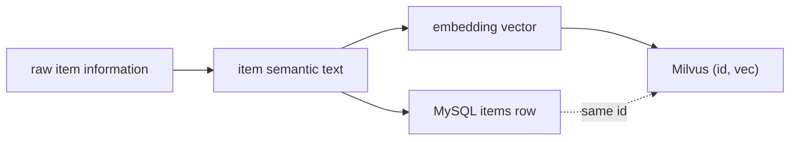
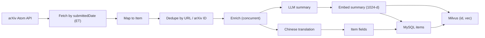

# Data pipeline (reference searcher)

[English](data-pipeline.md) · [中文](data-pipeline.zh-CN.md)

`searcher/` is a **reference** offline producer for arXiv. It is a separate Go module, not imported by the backend, and it writes to the same MySQL and Milvus that the backend reads.

> **The searcher is not required.** It is one concrete example of how to turn raw item information into an item semantic text and then into a vector. Your ingestion path can be an official API, a crawl, a CMS export, a CSV, a queue, an internal batch job, or a different language entirely. The framework only depends on the resulting data contract. **Borrow the flow, not necessarily the Go code.**

## The data contract

Whatever tool you use, the runtime expects this chain:



1. **Raw item information** — title, description, attributes, tags, source URL, etc.
2. **Item semantic text** — a concise, embedding-ready description. In LitStream this is `items.summary`; the reference searcher generates it with an LLM and falls back to the abstract/title.
3. **Embedding vector** — produced by the same model and dimension the backend uses for `interest_topics`.
4. **Two writes with the same ID** — a MySQL `items` row (for display/reranking metadata) and a Milvus `(id, vec)` entry. The backend loads metadata by ID from MySQL/Redis.

Common ingestion options:

| Source | Typical tooling | Notes |
| --- | --- | --- |
| Official API | Go/Python/Node client, scheduled job | Respect quotas and terms |
| Web crawl | Scrapy/Playwright/custom | Dedupe by canonical URL or SKU; legal review |
| CMS / database export | SQL/CSV + batch script | Stable internal IDs are ideal |
| Message queue | Kafka/Redis Streams consumer | Good for incremental updates |
| Manual/admin upload | CSV/JSON import | Fine for a small catalog |
| `searcher/` | Go CLI/container | Reference only; arXiv-specific |

If you use a different pipeline, you do **not** need to copy `searcher/`'s code or packages. You need to produce the same item contract.

## 1. Why the reference is a separate module

- Ingestion is batch work with very different failure modes from the API (arXiv pagination, long-running LLM/translation calls, partial batches).
- It can run as a one-shot container or a local CLI without starting the web server.
- It must use **exactly the same embedding model and vector dimension** as the backend. Sharing `.env` is the simplest way to keep them in sync in the reference implementation.
- Keeping ingestion out of the backend makes it obvious that the runtime has no dependency on the searcher.

## 2. Pipeline



The order is deliberate: **dedupe before enrichment**. Summary and translation calls cost money; an already-stored paper should not trigger them again.

## 3. Fetch

- Source: arXiv Atom API.
- Date semantics: arXiv `submittedDate` is in **US Eastern Time**, so "2025-01-15" means the ET day, not the local day.
- `-date` fetches one day; `-from`/`-to` fetches an inclusive range, one day at a time.
- `-max N` limits a run; `0` (default) paginates through the whole day.
- The client retries transient failures and has an IP fallback path for arXiv rate limiting.
- `-dry-run` maps and prints items without querying the database, calling an LLM, or writing.

## 4. Mapping and dedupe

`ingest/mapping.go` maps an arXiv paper to `domain.Item`:

| Item field | Source |
| --- | --- |
| `title` | Paper title |
| `web_source` | `"arxiv"` |
| `url` | arXiv ID (for example `http://arxiv.org/abs/2406.00001v1`) |
| `publish_date` | First 10 chars of the published timestamp (`YYYY-MM-DD`) |
| `authors` | Author list |
| `abstract` | Original abstract |
| `fields` | arXiv categories |
| `keywords` | Empty (arXiv has no keyword field) |
| `summary` | Generated later by enrichment |

The unique identifier is `items.url`, not the title. `domain.Item.Identifier()` trims whitespace and returns `url`.

Dedupe has two stages:

1. **Within the batch** — repeated identifiers keep the first occurrence.
2. **Against the database** — `ExistingIdentifiers` queries `items.url` with `Unscoped()` so even soft-deleted rows count as existing. Re-fetching a deleted paper does not silently insert a duplicate.

Items without an identifier are kept rather than dropped, because their duplicate status cannot be determined. They may be duplicated on a re-run.

## 5. Enrichment

For each new item, two calls run **concurrently** because they hit different services:

### Summary (`searcher/llm/summary.go`)

- Input: title + original abstract.
- Output: one continuous, embedding-ready text, ideally ≤500 tokens.
- Constraints in the prompt: keep terminology, no external facts, no markdown/JSON, no background or future-work filler, focus on problem / method / result.
- The code strips code fences and common prefixes, and rejects truncated output (`finish_reason=length`).
- On failure or missing summarizer, the fallback is the original abstract, then the title. Ingestion continues.

The summary is important twice over: it is the text that gets embedded for recall, and it is the text the reranker sees. A bad summary degrades both retrieval and ranking.

### Translation (`searcher/translator/`)

- The source language is detected first (`lang.IsMostlyChinese`, 50% Han-character threshold).
- Chinese items set `is_chinese=true` and skip translation.
- Non-Chinese items call the configured provider and fill `title_chinese` / `abstract_chinese`.
- Translation failure leaves the Chinese fields empty; ingestion still succeeds.
- Two providers:
  - `qwenmt` — Qwen-MT via DashScope, default `qwen-mt-lite`, ~60 RPM.
  - `alimt` — Alibaba Cloud Machine Translation, default QPS 50.

### Concurrency model

| Knob | Controls |
| --- | --- |
| `ENRICH_CONCURRENCY` | Number of papers processed at once |
| `SUMMARY_CONCURRENCY` | Concurrent summary requests |
| `TRANSLATE_CONCURRENCY` | Concurrent translation requests |
| `TRANSLATE_QPS` / `TRANSLATE_BURST` | Translation rate limit (token bucket, per provider) |

Each item-level worker launches the summary and translation branches in parallel. Per-provider gates are independent, so a slow translation queue does not block summary generation for other items.

The `.env.example` values (`ENRICH_CONCURRENCY=64`, `SUMMARY_CONCURRENCY=64`) are aggressive. Start at 8 and raise them only if the provider quota allows it.

## 6. Embedding

- The embedded text is `items.summary` (not the title and not the abstract).
- The searcher batches up to 10 inputs per request (the DashScope-compatible endpoint rejects larger batches in practice).
- `EMBEDDING_MODEL_NAME` and `VEC_DIM` must match the backend. The backend embeds `interest_topics` with the same model.
- A dimension mismatch is a hard error; vectors from different models are not comparable.

## 7. Store

`store.SaveItems` writes MySQL first, then Milvus:

1. Open a MySQL transaction.
2. Insert up to 200 items per batch; GORM fills auto-increment IDs.
3. Insert `(id, vec)` into Milvus for the same batch.
4. On Milvus failure, roll back MySQL.
5. Commit.

Trade-off: a failure after some Milvus inserts can leave **orphan vectors** whose MySQL rows were rolled back. They consume a candidate slot and are skipped when the backend cannot load metadata. The alternative — a MySQL row with no vector — would be invisible to retrieval forever and blocked by dedupe, which is worse.

`-op stats` reports both MySQL rows and Milvus vector counts and warns when they diverge.

## 8. Commands

These commands are specific to the reference searcher. Run them from `searcher/` locally, or prefix with `docker compose --profile tools run --rm searcher -config /app/.env` in Docker. If you use your own loader, ignore this section.

| Goal | Command |
| --- | --- |
| One day | `go run . -date 2025-01-15` |
| Date range | `go run . -from 2025-01-01 -to 2025-01-31` |
| Cap the run | `go run . -date 2025-01-15 -max 200` |
| Dry run | `go run . -date 2025-01-15 -dry-run` |
| Count | `go run . -op stats` |
| Covered dates | `go run . -op dates` |
| Delete a day | `go run . -op delete-date -date 2025-01-15 -yes` |
| Purge | `go run . -op purge -yes` |
| Re-translate | `go run . -op regen-translate -date 2025-01-15 -yes` |
| Re-summarize | `go run . -op regen-summary -date 2025-01-15 -yes` |
| Re-embed | `go run . -op regen-embedding -date 2025-01-15 -yes` |

`delete-date` and `purge` are hard deletes: MySQL rows are removed (including soft-deleted rows) and Milvus is updated. Without `-yes`, the command only reports the scope.

### Regeneration order

```text
regen-summary  ->  regen-embedding
regen-translate (independent)
```

The vector is computed from the summary. Changing the summary model without re-embedding leaves old vectors pointing at old text. After an embedding-model change, every vector must be regenerated; a partial migration creates two incompatible semantic spaces in one collection.

## 9. Using your own ingestion (without the searcher)

You can ignore `searcher/` entirely. A minimal loader in any language looks like this:

```text
for each raw item:
    semantic_text = enrich(raw_item)          # LLM or deterministic template
    vector        = embed(semantic_text)      # same model/dim as the backend
    row           = insert_mysql(items, ...)  # returns items.id
    insert_milvus(row.id, vector)             # same id
```

Checklist:

1. **Map fields** into the `items` columns the backend reads. Add columns only if the UI/reranker needs them.
2. **Produce one semantic text** per item. Store it in `items.summary` (or the field your prompts/docs designate).
3. **Embed with the same model and `VEC_DIM`** the backend uses for `interest_topics`.
4. **Write MySQL first**, get the auto-increment `id`, then write `(id, vec)` to Milvus. If Milvus fails, roll back the MySQL batch or clean up the row.
5. **Dedupe before enrichment** so you do not pay for LLM/translation calls on items already stored.
6. **Verify** that `items` rows and Milvus vectors have the same count and that a sample query returns the expected IDs.
7. **Decide about translation**: it is optional. If you skip it, leave `title_chinese` / `abstract_chinese` empty; the feed and the Chinese toggle degrade gracefully.

You do not need the `tools` Compose profile, the searcher Dockerfile, or the arXiv packages. Those exist only to make the reference path reproducible.

## 10. Failure and degradation

| Failure | Behavior |
| --- | --- |
| arXiv fetch fails | Retries; the run aborts if the page cannot be fetched |
| One summary call fails | Retries; then falls back to abstract/title for that item |
| One translation fails | Chinese fields stay empty; item is still stored |
| Embedding batch fails | The run aborts before writing that batch |
| Milvus insert fails | MySQL batch is rolled back; orphan vectors may remain |
| Ctrl-C | Context cancellation stops new calls; already-enriched items may still be written |
| Duplicate re-run | Existing identifiers are filtered before enrichment |

## 11. Cost and throughput (design estimate, not a benchmark)

The original searcher notes estimate that 500 papers require two calls each (summary + translation). At 2–5 seconds per call, a fully serial run would take roughly 30–80 minutes. With item-level concurrency (default 8) and the two calls per item running concurrently, the wall-clock time drops to minutes, with provider queuing/rate limits becoming the new bottleneck.

This is an estimate, not a measured result. The project's performance section is intentionally unpublished; see the [main README](../README.md#4-performance).

## 12. Adapting the pipeline to another vertical

1. **Choose an ingestion path.** Extend `searcher/` if its flow fits, or write a new loader in any language. The searcher is not a required dependency.
2. **Map raw fields** into the `items` schema. Keep a stable identifier; the reference uses `items.url`. If you need a dedicated SKU/ID column, add it and update the dedupe query.
3. **Decide what text is embedded.** In LitStream it is `summary`; for products it might be `title + brand + key attributes`. Keep it one field so the reranker and the embedder see the same text.
4. **Generate the semantic text.** If you use an LLM, rewrite the summary prompt for the domain (see the [reuse guide](reuse-guide.md)). Keep the output as one plain text block, not JSON, because it is embedded directly.
5. **Set `VEC_DIM` and the embedding model**, create the collection, and run a small batch before a full import.
6. **Adjust translation**: it is optional. For an English-only catalog, disable it; for multilingual, keep the provider and rate limits.
7. **Verify consistency** between MySQL rows and Milvus vectors after the first batch.

Do not mix items from two embedding models in one collection. If you need multiple verticals, use a separate collection per vertical (and a separate prompt set), then route at the application layer.
