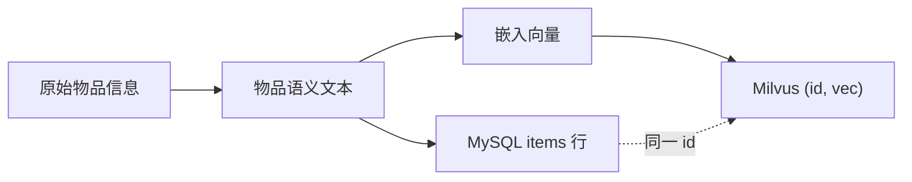
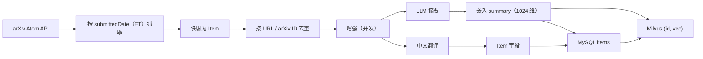

# 数据管线（参考 searcher/）

[English](data-pipeline.md) · [中文](data-pipeline.zh-CN.md)

`searcher/` 是面向 arXiv 的**参考**离线生产者。它是一个独立的 Go module，后端不会 import 它，它写入的正是后端所读取的同一套 MySQL 和 Milvus。

> **searcher/ 并非必需。** 它只是"把原始物品信息转成物品语义文本、再转成向量"的一个具体示例。你的入库路径可以是官方 API、爬虫、CMS 导出、CSV、消息队列、内部批处理任务，甚至完全用另一种语言实现。框架只依赖最终的数据契约。**借鉴流程，而不一定要照搬 Go 代码。**

## 数据契约

无论你用什么工具，运行时都期望这样一条链路：



1. **原始物品信息** —— 标题、描述、属性、标签、来源 URL 等。
2. **物品语义文本** —— 一段简洁、可直接用于嵌入的描述。在 LitStream 中它就是 `items.summary`；参考 searcher 用 LLM 生成它，失败时回退到摘要/标题。
3. **嵌入向量** —— 必须由与后端处理 `interest_topics` 时相同的模型、相同的维度产出。
4. **两次写入使用同一个 ID** —— 一行 MySQL `items` 记录（用于展示/精排所需的元数据）和一条 Milvus `(id, vec)` 记录。后端按 ID 从 MySQL/Redis 加载元数据。

常见的入库方案：

| 来源 | 常用工具 | 说明 |
| --- | --- | --- |
| 官方 API | Go/Python/Node 客户端、定时任务 | 遵守配额与使用条款 |
| 网页抓取 | Scrapy/Playwright/自研 | 按规范 URL 或 SKU 去重；需做合规审查 |
| CMS / 数据库导出 | SQL/CSV + 批处理脚本 | 有稳定的内部 ID 最理想 |
| 消息队列 | Kafka/Redis Streams 消费者 | 适合增量更新 |
| 手动/后台上传 | CSV/JSON 导入 | 小规模物品库够用 |
| `searcher/` | Go CLI/容器 | 仅作参考；面向 arXiv |

如果你使用别的管线，**不需要**复制 `searcher/` 的代码或 package，你只需要产出相同的物品契约。

## 1. 为什么参考实现被拆成独立 module

- 入库是批处理工作，其失败模式与 API 差别很大（arXiv 分页、耗时的 LLM/翻译调用、部分批次失败）。
- 它可以作为一次性容器或本地 CLI 运行，无需启动 Web 服务。
- 它必须与后端使用**完全相同的嵌入模型和向量维度**。在参考实现中，共享 `.env` 是保持两者一致的最简单方式。
- 把入库排除在后端之外，可以清楚地表明运行时不依赖 searcher。

## 2. 管线



这个顺序是有意为之：**先去重，再增强**。摘要和翻译调用都要花钱，已经入库的论文不应再次触发这些调用。

## 3. 抓取

- 数据源：arXiv Atom API。
- 日期语义：arXiv 的 `submittedDate` 使用**美国东部时间**，所以 "2025-01-15" 指的是 ET 时区的那一天，而不是本地时区的那一天。
- `-date` 抓取一天；`-from`/`-to` 抓取一个闭区间，逐天处理。
- `-max N` 限制单次运行的数量；`0`（默认值）表示分页处理整天数据。
- 客户端会对瞬时失败进行重试，并针对 arXiv 的限流准备了 IP 回退路径。
- `-dry-run` 只做映射并打印物品，不查询数据库、不调用 LLM、不写入。

## 4. 映射与去重

`ingest/mapping.go` 把一篇 arXiv 论文映射为 `domain.Item`：

| 物品字段 | 来源 |
| --- | --- |
| `title` | 论文标题 |
| `web_source` | `"arxiv"` |
| `url` | arXiv ID（例如 `http://arxiv.org/abs/2406.00001v1`） |
| `publish_date` | 发布时间戳的前 10 个字符（`YYYY-MM-DD`） |
| `authors` | 作者列表 |
| `abstract` | 原始摘要 |
| `fields` | arXiv 分类 |
| `keywords` | 为空（arXiv 没有关键词字段） |
| `summary` | 稍后由增强阶段生成 |

唯一标识是 `items.url`，而不是标题。`domain.Item.Identifier()` 会去掉首尾空白并返回 `url`。

去重分为两个阶段：

1. **批内去重** —— 重复的标识只保留第一次出现的那条。
2. **对库去重** —— `ExistingIdentifiers` 用 `Unscoped()` 查询 `items.url`，因此即使是被软删除的行也算作已存在。重新抓取一篇已删除的论文不会悄悄插入重复记录。

没有标识的物品会被保留而不是丢弃，因为无法判断它们是否重复。重新运行时它们可能会重复。

## 5. 增强

对每个新物品，两路调用**并发**执行，因为它们访问的是不同的服务：

### 摘要（`searcher/llm/summary.go`）

- 输入：标题 + 原始摘要。
- 输出：一段连续、可直接用于嵌入的文本，理想情况下不超过 500 token。
- 提示词中的约束：保留术语，不引入外部事实，不使用 markdown/JSON，不写背景或未来工作之类的填充内容，聚焦问题 / 方法 / 结果。
- 代码会清除 code fence 和常见前缀，并拒绝被截断的输出（`finish_reason=length`）。
- 失败或未配置摘要器时，回退到原始摘要，再回退到标题。入库继续进行。

摘要的重要性是双重的：它既是被嵌入用于召回的文本，也是精排器看到的文本。糟糕的摘要会同时拖累检索和排序。

### 翻译（`searcher/translator/`）

- 先检测源语言（`lang.IsMostlyChinese`，汉字占比 50% 阈值）。
- 中文物品设置 `is_chinese=true` 并跳过翻译。
- 非中文物品调用配置好的 provider，填充 `title_chinese` / `abstract_chinese`。
- 翻译失败会让中文字段留空，入库仍然成功。
- 两个 provider：
  - `qwenmt` —— 通过 DashScope 调用 Qwen-MT，默认 `qwen-mt-lite`，约 60 RPM。
  - `alimt` —— 阿里云机器翻译，默认 QPS 50。

### 并发模型

| 参数 | 控制内容 |
| --- | --- |
| `ENRICH_CONCURRENCY` | 同时处理的论文数 |
| `SUMMARY_CONCURRENCY` | 并发摘要请求数 |
| `TRANSLATE_CONCURRENCY` | 并发翻译请求数 |
| `TRANSLATE_QPS` / `TRANSLATE_BURST` | 翻译限流（令牌桶，按 provider 独立） |

每个物品级 worker 会并行启动摘要和翻译两条分支。各 provider 的限流闸门相互独立，因此翻译队列变慢不会阻塞其他物品的摘要生成。

`.env.example` 里的取值（`ENRICH_CONCURRENCY=64`、`SUMMARY_CONCURRENCY=64`）偏激进。建议从 8 开始，只在 provider 配额允许时才调高。

## 6. 嵌入

- 被嵌入的文本是 `items.summary`（不是标题，也不是摘要）。
- searcher 每个请求最多批量提交 10 条输入（实践中 DashScope 兼容端点会拒绝更大的批量）。
- `EMBEDDING_MODEL_NAME` 与 `VEC_DIM` 必须与后端一致。后端用同一个模型嵌入 `interest_topics`。
- 维度不匹配是硬错误；来自不同模型的向量不可比较。

## 7. 存储

`store.SaveItems` 先写 MySQL，再写 Milvus：

1. 开启 MySQL 事务。
2. 每批最多插入 200 个物品；GORM 会回填自增 ID。
3. 为同一批数据向 Milvus 插入 `(id, vec)`。
4. Milvus 失败则回滚 MySQL。
5. 提交。

取舍：如果在部分 Milvus 插入之后失败，可能留下 **孤儿向量** —— 它们的 MySQL 行已被回滚。这些向量会占用一个候选名额，并在后端无法加载元数据时被跳过。反过来做（有 MySQL 行但没有向量）会让该物品永远对检索不可见，而且会被去重拦住，这更糟。

`-op stats` 会同时报告 MySQL 行数和 Milvus 向量数，并在两者不一致时给出警告。

## 8. 命令

这些命令专属于参考 searcher。在本地请从 `searcher/` 目录运行；在 Docker 中请在前面加上 `docker compose --profile tools run --rm searcher -config /app/.env`。如果你用自己的加载器，可以忽略本节。

| 目标 | 命令 |
| --- | --- |
| 处理一天 | `go run . -date 2025-01-15` |
| 处理日期区间 | `go run . -from 2025-01-01 -to 2025-01-31` |
| 限制本次运行量 | `go run . -date 2025-01-15 -max 200` |
| 试运行 | `go run . -date 2025-01-15 -dry-run` |
| 统计数量 | `go run . -op stats` |
| 已覆盖的日期 | `go run . -op dates` |
| 删除某一天 | `go run . -op delete-date -date 2025-01-15 -yes` |
| 清空 | `go run . -op purge -yes` |
| 重新翻译 | `go run . -op regen-translate -date 2025-01-15 -yes` |
| 重新生成摘要 | `go run . -op regen-summary -date 2025-01-15 -yes` |
| 重新嵌入 | `go run . -op regen-embedding -date 2025-01-15 -yes` |

`delete-date` 和 `purge` 是硬删除：MySQL 行会被移除（包括已软删除的行），并同步更新 Milvus。不加 `-yes` 时，命令只报告影响范围。

### 重新生成的顺序

```text
regen-summary  ->  regen-embedding
regen-translate (independent)
```

向量是由摘要计算出来的。只更换摘要模型而不重新嵌入，会让旧向量仍指向旧文本。更换嵌入模型后，所有向量都必须重新生成；迁移不完整会在同一个 collection 里留下两套互不兼容的语义空间。

## 9. 使用自己的入库流程（不用 searcher/）

你完全可以忽略 `searcher/`。任何语言写的最小加载器大致如下：

```text
for each raw item:
    semantic_text = enrich(raw_item)          # LLM or deterministic template
    vector        = embed(semantic_text)      # same model/dim as the backend
    row           = insert_mysql(items, ...)  # returns items.id
    insert_milvus(row.id, vector)             # same id
```

检查清单：

1. **映射字段**，填入后端会读取的 `items` 列。只有当 UI/精排器需要时才新增列。
2. **为每个物品生成一段语义文本**，存入 `items.summary`（或你的提示词/文档指定的字段）。
3. **使用与后端处理 `interest_topics` 时相同的模型和 `VEC_DIM` 做嵌入**。
4. **先写 MySQL**，拿到自增 `id`，再向 Milvus 写 `(id, vec)`。如果 Milvus 失败，回滚这批 MySQL 或清理该行。
5. **在增强之前去重**，避免为已入库的物品重复支付 LLM/翻译调用。
6. **校验** `items` 行数与 Milvus 向量数一致，并确认抽样查询返回预期的 ID。
7. **决定是否翻译**：翻译是可选的。如果跳过，就让 `title_chinese` / `abstract_chinese` 留空；feed 和中文开关会优雅降级。

你不需要 `tools` 这个 Compose profile、searcher 的 Dockerfile，也不需要那些 arXiv 相关的 package。它们的存在只是为了让参考路径可复现。

## 10. 失败与降级

| 失败情形 | 行为 |
| --- | --- |
| arXiv 抓取失败 | 重试；若该页无法获取则本次运行中止 |
| 某次摘要调用失败 | 重试；之后该物品回退到摘要/标题 |
| 某次翻译失败 | 中文字段留空；物品仍会被存储 |
| 嵌入批次失败 | 本次运行在写入该批次之前中止 |
| Milvus 插入失败 | 回滚该批 MySQL；可能残留孤儿向量 |
| Ctrl-C | 上下文取消会停止新的调用；已增强的物品可能仍被写入 |
| 重复运行 | 已存在的标识会在增强之前被过滤掉 |

## 11. 成本与吞吐（设计估算，非基准测试）

原始 searcher 的笔记估算：500 篇论文每篇需要两次调用（摘要 + 翻译）。按每次调用 2–5 秒计算，完全串行大约需要 30–80 分钟。若开启物品级并发（默认 8），且每个物品的两次调用并发执行，实际耗时可以降到分钟级，此时 provider 的排队/限流会成为新的瓶颈。

这是估算，不是实测结果。本项目的性能章节有意不公开；参见[主 README](../README.zh-CN.md#4-性能测试)。

## 12. 将管线适配到其他垂直领域

1. **选择一条入库路径。** 如果 `searcher/` 的流程合适就扩展它，否则用任意语言写一个新的加载器。searcher 不是必需的依赖。
2. **把原始字段映射**到 `items` schema。保留一个稳定的标识；参考实现用的是 `items.url`。如果你需要专门的 SKU/ID 列，就新增该列并同步修改去重查询。
3. **确定要嵌入什么文本。** 在 LitStream 中是 `summary`；对商品而言可能是 `title + brand + key attributes`。让它保持为单个字段，这样精排器和嵌入器看到的是同一段文本。
4. **生成语义文本。** 如果用 LLM，请针对领域改写摘要提示词（见[复用指南](reuse-guide.zh-CN.md)）。输出要保持为一段纯文本而不是 JSON，因为它会被直接嵌入。
5. **设置 `VEC_DIM` 和嵌入模型**，创建 collection，并在全量导入前先跑一个小批量。
6. **调整翻译**：它是可选的。纯英文物品库可以关闭；多语言场景则保留 provider 和限流配置。
7. **在首批数据之后校验** MySQL 行与 Milvus 向量之间的一致性。

不要把来自两个嵌入模型的物品混在同一个 collection 里。如果你需要多个垂直领域，请为每个领域使用独立的 collection（以及独立的提示词集），然后在应用层做路由。
